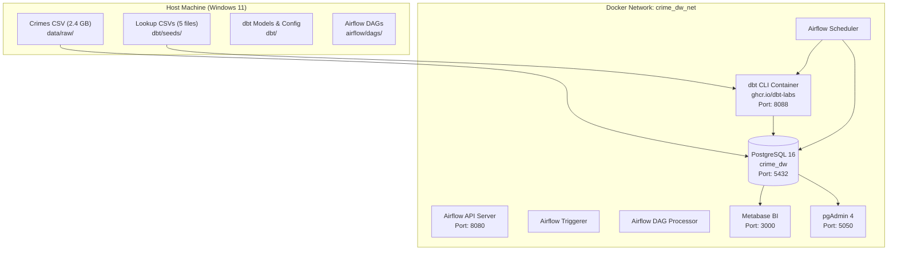
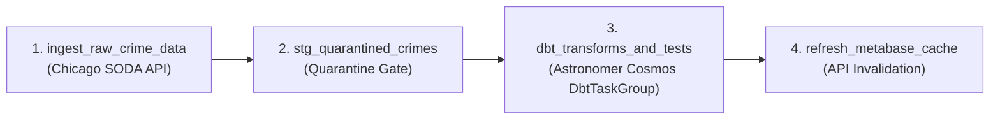

# Chicago Crime Data Warehouse: Technical Checkpoint Report (DWH_V01)
**Project Title:** End-to-End Enterprise Data Warehouse for Chicago Spatial-Temporal Crime Dataset  
**Course Curriculum:** Data Warehousing (IT KMITL, Weeks 1–11)  
**Authoritative Reference:** `Docs/Data_Warehouse_Architecture_Design_Document_Chicago_V3.pdf` (v1.2, Oct 14, 2026)  
**Checkpoint Date:** October 16, 2026  
**Status:** ✅ Production Ready (All Layers Implemented, Validated, and Operational)

---

## 1. Executive Summary & Overview

โปรเจกต์นี้เป็นการพัฒนาระบบคลังข้อมูลระดับองค์กร (Enterprise Data Warehouse) สำหรับชุดข้อมูลอาชญากรรมเมืองชิคาโก (Chicago Crime Dataset 2001–ปัจจุบัน ขนาดข้อมูลดิบ 2.4 GB รวมกว่า 8.66 ล้านแถว) โดยประยุกต์ใช้ระเบียบวิธีวิจัยและการออกแบบเชิงมิติตามมาตรฐาน **Kimball Dimensional Modeling (Star Schema)** บนสถาปัตยกรรม **Modern Data Stack (MDS)** ประกอบด้วย:

* **Relational Storage & Partitioning:** PostgreSQL 16 (ฐานข้อมูล `crime_dw`)
* **Transformation & Quality Testing:** dbt Core 1.8.x (`dbt-postgres`)
* **Workflow Orchestration & Lineage:** Apache Airflow 3.x + Astronomer Cosmos (`DbtTaskGroup`)
* **Business Intelligence & Dashboards:** Metabase BI
* **Containerization:** Docker Compose (8 คอนเทนเนอร์เชื่อมโยงกันบนเน็ตเวิร์กเสมือน)

ณ จุด Checkpoint นี้ ระบบได้ผ่านการสร้างโครงสร้างพื้นฐาน การโหลดข้อมูลความเร็วสูง การทำ Data Cleansing & Quarantine Gate การสร้าง Conformed Dimensions ครบทั้ง 5 มิติ การสร้าง Partitioned Fact Table การสร้าง Data Marts 2 โมเดล และผ่านการทดสอบคุณภาพข้อมูลด้วย dbt test ครบทั้ง **28 รายการ (100% Pass)**

---

## 2. Infrastructure & Container Architecture

ระบบทำงานผ่าน Docker Compose (`our_project/docker-compose.yaml`) โดยมี 8 Services ทำงานร่วมกันอย่างเป็นระบบ:



### สรุปพอร์ตและจุดเข้าถึงบริการ (Service Endpoints)
| Service | Container Name | URL / Port | Credentials / Purpose |
| :--- | :--- | :---: | :--- |
| **PostgreSQL 16** | `crime_dw_postgres` | `localhost:5432` | DB: `crime_dw` / User: `postgres`, `bi_reader` |
| **Airflow Web UI** | `crime_dw_airflow_apiserver` | `http://localhost:8080` | User: `admin` / Pass: `admin` |
| **Metabase BI** | `crime_dw_metabase` | `http://localhost:3000` | BI Dashboards & Spatial Heatmaps |
| **pgAdmin 4** | `crime_dw_pgadmin` | `http://localhost:5050` | User: `admin@crimedw.com` / Pass: `admin_secret_pass` |
| **dbt CLI** | `crime_dw_dbt` | `localhost:8088` | รันคำสั่ง `dbt run`, `dbt test`, `dbt docs` |

---

## 3. Data Warehouse Storage Layers & Dimensional Modeling

คลังข้อมูลถูกออกแบบแบ่งแยกหน้าที่ชัดเจนตามสถาปัตยกรรม 3 ชั้น (3-Tier Storage Layers):

```
raw_staging (Ingestion & Quarantine) 
    ──► core_dw (Star Schema: 1 Fact + 5 Dimensions) 
            ──► data_marts (Pre-aggregated Analytical Tables)
```

```mermaid
erDiagram
    fact_crime_incident }|--|| dim_date : "date_key"
    fact_crime_incident }|--|| dim_time : "time_key"
    fact_crime_incident }|--|| dim_crime_type : "crime_type_key"
    fact_crime_incident }|--|| dim_location_type : "location_type_key"
    fact_crime_incident }|--|| dim_location : "location_key (SCD2)"

    fact_crime_incident {
        BIGINT incident_key PK
        INTEGER date_key FK
        INTEGER time_key FK
        INTEGER location_key FK
        INTEGER crime_type_key FK
        INTEGER location_type_key FK
        BIGINT source_id
        VARCHAR case_number
        SMALLINT incident_count
        SMALLINT arrest_flag
        SMALLINT domestic_flag
        TIMESTAMPTZ source_updated_at
    }

    dim_crime_type {
        INTEGER crime_type_key PK
        VARCHAR iucr_code NK
        VARCHAR primary_type
        VARCHAR description
        BOOLEAN is_index_crime
    }

    dim_time {
        INTEGER time_key PK
        SMALLINT hour_24
        SMALLINT minute
        VARCHAR period_name
        VARCHAR shift_name
    }

    dim_date {
        INTEGER date_key PK
        DATE full_date
        SMALLINT day_of_week
        VARCHAR day_name
        SMALLINT month_no
        SMALLINT year
        BOOLEAN is_weekend
        BOOLEAN is_holiday
    }

    dim_location_type {
        INTEGER location_type_key PK
        VARCHAR location_desc NK
    }

    dim_location {
        INTEGER location_key PK
        VARCHAR beat_code NK
        VARCHAR district_id NK
        INTEGER ward_num NK
        VARCHAR community_area_id NK
        DATE effective_start_date
        DATE effective_end_date
        BOOLEAN is_current
    }
```

---

## 4. ผลสรุปตารางและจำนวนแถวในคลังข้อมูล (Warehouse Volume Metrics)

จากการรันคำสั่งตรวจสอบขนาดและความจุของทุกตารางในฐานข้อมูล PostgreSQL (`crime_dw`) ได้ผลลัพธ์จริงดังนี้:

| Schema | Table Name | ชนิดของตาราง | จำนวนแถว (Row Count) | ขนาดบนดิสก์ |
| :--- | :--- | :--- | :---: | :---: |
| **`raw_staging`** | `raw_crimes` | ตารางข้อมูลดิบนำเข้า (22 คอลัมน์) | **8,659,584** | 4,943 MB |
| **`raw_staging`** | `quarantine_crime_records` | ตารางกักกันข้อมูลผิดปกติ | **149** | 168 kB |
| **`raw_staging`** | `iucr_codes` | Reference Seed: มาตรฐานรหัสคดี CPD | **434** | 72 kB |
| **`raw_staging`** | `police_beats` | Reference Seed: เขตตรวจย่อยสายตรวจ | **277** | 1,888 kB |
| **`raw_staging`** | `community_areas` | Reference Seed: ชุมชนสถิติชิคาโก | **77** | 1,256 kB |
| **`raw_staging`** | `chicago_wards` | Reference Seed: เขตการเมืองสภาเมือง | **50** | 16 kB |
| **`raw_staging`** | `police_districts` | Reference Seed: สถานีตำรวจประจำเขต | **25** | 664 kB |
| **`core_dw`** | `dim_date` | มิติปฏิทิน 30 ปี (2001–2030) + วันหยุดราชการ | **10,959** | 776 kB |
| **`core_dw`** | `dim_location` | มิติพื้นที่ SCD Type 2 (Composite Natural Keys) | **2,069** | 264 kB |
| **`core_dw`** | `dim_time` | มิติเวลารายนาที 24 ชม. + กะสายตรวจ CPD | **1,441** | 144 kB |
| **`core_dw`** | `dim_crime_type` | มิติประเภทคดี + ระบุคดีอุกฉกรรจ์ (Index Crime) | **435** | 72 kB |
| **`core_dw`** | `dim_location_type` | มิติลักษณะทางกายภาพของสถานที่เกิดเหตุ | **219** | 24 kB |
| **`core_dw`** | **`fact_crime_incident`** | **ตารางข้อเท็จจริงหลัก (รวมทุกพาร์ทิชัน)** | **8,659,435** | **~2,036 MB** |
| *-- Partition* | `fact_crime_incident_y2021` | พาร์ทิชันปี 2021 | 210,009 | 50 MB |
| *-- Partition* | `fact_crime_incident_y2022` | พาร์ทิชันปี 2022 | 240,500 | 56 MB |
| *-- Partition* | `fact_crime_incident_y2023` | พาร์ทิชันปี 2023 | 263,856 | 61 MB |
| *-- Partition* | `fact_crime_incident_y2024` | พาร์ทิชันปี 2024 | 259,660 | 60 MB |
| *-- Partition* | `fact_crime_incident_y2025` | พาร์ทิชันปี 2025 | 238,145 | 55 MB |
| *-- Partition* | `fact_crime_incident_y2026` | พาร์ทิชันปี 2026 | 178,667 | 42 MB |
| *-- Partition* | `fact_crime_incident_default` | พาร์ทิชันข้อมูลอดีต (ปี 2001–2020) | 7,268,263 | 1,712 MB |
| **`data_marts`** | `mart_daily_beat_crime_summary` | สรุปยอดคดีรายวันระดับ Beat + อัตราจับกุม | **6,578,025** | 692 MB |
| **`data_marts`** | `mart_spatial_heatmap` | เมทริกซ์ความหนาแน่นเชิงพื้นที่ + Centroid Lat/Lon | **8,325,350** | 1,209 MB |
| **ยอดรวมทั้งระบบ** | | **ขนาดพื้นที่ฐานข้อมูลรวมในดิสก์** | | **8,898 MB (~8.9 GB)** |

---

## 5. การทดสอบคุณภาพข้อมูลอัตโนมัติ (dbt Test Suite)

ระบบได้รันชุดทดสอบคุณภาพข้อมูล (Data Quality Assertions) อัตโนมัติผ่าน dbt test จำนวน **28 การทดสอบ** ผลปรากฏว่า **ผ่านครบ 100% (28 PASS, 0 FAIL, 0 WARN)**:

```text
17:01:44 1 of 28 PASS not_null_dim_crime_type_crime_type_key ......... [PASS]
17:01:44 2 of 28 PASS not_null_dim_crime_type_iucr_code ............... [PASS]
17:01:44 3 of 28 PASS not_null_dim_date_date_key ...................... [PASS]
17:01:44 4 of 28 PASS not_null_dim_date_full_date ..................... [PASS]
17:01:44 5 of 28 PASS not_null_dim_location_location_key .............. [PASS]
17:01:44 6 of 28 PASS not_null_dim_location_type_location_desc ........ [PASS]
17:01:44 7 of 28 PASS not_null_dim_location_type_location_type_key .... [PASS]
17:01:44 8 of 28 PASS not_null_dim_time_time_key ...................... [PASS]
17:01:52 9 of 28 PASS not_null_fact_crime_incident_crime_type_key ..... [PASS]
17:01:52 10 of 28 PASS not_null_fact_crime_incident_date_key .......... [PASS]
17:01:52 11 of 28 PASS not_null_fact_crime_incident_incident_key ...... [PASS]
17:01:52 12 of 28 PASS not_null_fact_crime_incident_location_key ...... [PASS]
17:01:54 13 of 28 PASS not_null_mart_daily_beat_crime_summary_beat_code [PASS]
17:01:55 14 of 28 PASS not_null_mart_daily_beat_crime_summary_date_key  [PASS]
17:01:57 15 of 28 PASS not_null_mart_daily_beat_crime_summary_primary_type [PASS]
17:01:58 16 of 28 PASS not_null_mart_spatial_heatmap_centroid_latitude  [PASS]
17:01:59 17 of 28 PASS not_null_fact_crime_incident_source_id ......... [PASS]
17:01:59 18 of 28 PASS not_null_fact_crime_incident_time_key .......... [PASS]
17:02:00 19 of 28 PASS not_null_mart_spatial_heatmap_centroid_longitude [PASS]
17:02:01 20 of 28 PASS not_null_mart_spatial_heatmap_date_key ......... [PASS]
17:02:07 21 of 28 PASS relationships_fact_crime_incident_location_key__dim_location [PASS]
17:02:07 22 of 28 PASS relationships_fact_crime_incident_crime_type_key__dim_crime_type [PASS]
17:02:07 23 of 28 PASS relationships_fact_crime_incident_location_type_key__dim_location_type [PASS]
17:02:07 24 of 28 PASS unique_dim_crime_type_crime_type_key .......... [PASS]
17:02:07 25 of 28 PASS unique_dim_crime_type_iucr_code ............... [PASS]
17:02:08 26 of 28 PASS relationships_fact_crime_incident_date_key__dim_date [PASS]
17:02:11 27 of 28 PASS relationships_fact_crime_incident_time_key__dim_time [PASS]
17:02:11 28 of 28 PASS unique_dim_date_date_key ....................... [PASS]
========================================================================================
Finished running 28 data tests in 30.68 seconds. Done. PASS=28 WARN=0 ERROR=0
```

---

## 6. Business Intelligence & Dashboards (Metabase)

ระบบเชื่อมต่อกับผู้ใช้ผ่าน **Metabase BI** ([http://localhost:3000](http://localhost:3000)) โดยใช้สิทธิ์ผู้ใช้งานเฉพาะกิจ `bi_reader` (Read-only on `data_marts`) เพื่อความปลอดภัยตามหลักการ Principle of Least Privilege:

### การออกแบบ 2 แดชบอร์ดหลัก:
1. **Executive Decision Dashboard (ภาพรวมเชิงกลยุทธ์สำหรับผู้บริหาร):**
   * **Overall Arrest Rate % Card:** คำนวณอัตราการจับกุมภาพรวมด้วย Non-additive Metric Formula:
     $$\text{Arrest Rate \%} = \frac{\sum(\text{Total Arrests})}{\sum(\text{Total Incidents})} \times 100 \quad (\approx 25.43\%)$$
   * **Total Incidents & Total Index Crimes:** ยอดรวมคดีและคดีอุกฉกรรจ์
   * **Monthly Crime Trend:** กราฟเส้นแนวโน้มคดีรายเดือนย้อนหลัง
   * **Top Crime Types:** กราฟแท่งจำแนกประเภทคดี 10 อันดับแรก
2. **Tactical Patrol Dashboard (การวางแผนกำลังพลและสายตรวจ):**
   * **Chicago Spatial Crime Heatmap:** แผนที่ความร้อนระบุพิกัดจุดกึ่งกลาง (`centroid_latitude`, `centroid_longitude`) แสดงความหนาแน่นของคดีทั่วเมืองชิคาโกอย่างรวดเร็ว ($\le 1.5$ วินาที) โดยตั้งค่าการจัดกลุ่มพิกัดเป็น `Don't bin`
   * **Patrol Shift Distribution (Donut Chart):** สัดส่วนการเกิดเหตุตาม 3 กะสายตรวจ (`Morning`, `Afternoon`, `Night`)
   * **Hourly Crime Distribution (Area Chart):** ช่วงเวลาเสี่ยงสูงสุดในรอบวัน (Peak Hours)
   * **High-Risk Beats Ranking (Table):** ตารางจัดอันดับเขตตรวจย่อยที่ต้องเฝ้าระวังพิเศษ 20 อันดับแรก

---

## 7. Workflow Orchestration & Pipelines (Apache Airflow 3.x + Cosmos)

* **DAG ID:** `crime_dw_daily_pipeline` ([crime_dw_daily.py](file:///c:/Users/User/Downloads/IT_KMITL_Education/year3/semester_1/DataWarehouse/data-warehouse-2026-byNoppo/our_project/airflow/dags/crime_dw_daily.py))
* **ตารางเวลา (Schedule):** `0 2 * * *` (02:00 AM America/Chicago หรือ 14:00 PM เวลาประเทศไทย)
* **สถานะปัจจุบัน:** Active, Unpaused, พร้อมรองรับรอบการทำงานอัตโนมัติ



---

## 8. คู่มือการบำรุงรักษาและการจัดการคอนเทนเนอร์ (Operational Cheatsheet)

### การปิด-เปิดระบบอย่างปลอดภัย (Data Persistence Guarantee)
เนื่องจากข้อมูลทั้งหมดถูกผูกไว้กับ Named Volumes (`pg_data`, `metabase_data`, `pgadmin_data`) จึงมีความปลอดภัย 100%:

* **เมื่อต้องการพักการทำงานชั่วคราว (แนะนำ):**
  ```bash
  docker compose stop
  ```
* **เมื่อต้องการเปิดระบบกลับมาทำงานต่อ:**
  ```bash
  docker compose start
  ```
* **หากใช้คำสั่ง down:**
  ```bash
  docker compose down
  ```
  *(ข้อมูลยังคงอยู่ครบ เปิดใหม่ด้วย `docker compose up -d`)*
* ⚠️ **ข้อควรระวังขั้นวิกฤต:** **ห้ามใส่ `-v` เด็ดขาด** (`docker compose down -v`) เพราะจะทำการลบข้อมูลใน Database และ Metabase ทิ้งทั้งหมด

### คำสั่งตรวจสอบสถานะด่วน (Health Check CLI)
```bash
# ตรวจสอบสถานะคอนเทนเนอร์ทั้งหมด
docker compose ps

# เข้าไปรันคิวรีใน PostgreSQL
docker exec -it crime_dw_postgres psql -U postgres -d crime_dw

# รันชุดทดสอบคุณภาพข้อมูล dbt
docker exec -it crime_dw_dbt dbt test

# ตรวจสอบสถานะ Airflow DAG
docker exec -it crime_dw_airflow_scheduler airflow dags list
```

---

## 9. ภาคผนวกโค้ดโปรเจกต์ฉบับสมบูรณ์ (Complete Project Codebase Appendices)

เพื่อประโยชน์ในการตรวจรับมอบโครงการและการอ้างอิงทางเทคนิค ส่วนนี้รวบรวมโค้ดต้นฉบับจริงทุกไฟล์ที่ใช้ในการสร้าง คลีน แปลงสภาพ ทดสอบ และบริหารจัดการคลังข้อมูลชิคาโกไว้ทั้งหมด

---

### ภาคผนวก ก: สคริปต์สร้างฐานข้อมูลและโครงสร้างเริ่มต้น (DDL Migration)
* **ไฟล์:** `scripts/001_init_schemas.sql`
* **หน้าที่:** สร้าง Schemas (`raw_staging`, `core_dw`, `data_marts`), ตารางนำเข้าดิบ, ตารางกักกัน, ตาราง Partitioned Fact และสิทธิ์ผู้ใช้ `bi_reader`

```sql
-- ==============================================================================
-- 001_init_schemas.sql
-- Chicago Spatial-Temporal Crime Data Warehouse Initialization Script
-- Derived from Appendix A of Data Warehouse Architecture Design Document V3
-- ==============================================================================

-- 1. Create Data Warehouse Layers (Postgres Schemas)
CREATE SCHEMA IF NOT EXISTS raw_staging;
CREATE SCHEMA IF NOT EXISTS core_dw;
CREATE SCHEMA IF NOT EXISTS data_marts;

-- 2. Create Raw Staging Ingestion Table
CREATE TABLE IF NOT EXISTS raw_staging.raw_crimes (
    id BIGINT,
    case_number VARCHAR(50),
    date VARCHAR(50),
    block VARCHAR(150),
    iucr VARCHAR(10),
    primary_type VARCHAR(100),
    description VARCHAR(255),
    location_description VARCHAR(150),
    arrest VARCHAR(10),
    domestic VARCHAR(10),
    beat VARCHAR(20),
    district VARCHAR(20),
    ward VARCHAR(20),
    community_area VARCHAR(20),
    fbi_code VARCHAR(20),
    x_coordinate VARCHAR(50),
    y_coordinate VARCHAR(50),
    year VARCHAR(10),
    updated_on VARCHAR(50),
    latitude VARCHAR(50),
    longitude VARCHAR(50),
    location VARCHAR(100),
    _loaded_at TIMESTAMPTZ DEFAULT CURRENT_TIMESTAMP,
    _batch_id VARCHAR(100) DEFAULT 'INITIAL_LOAD'
);

-- 3. Create Quarantine Table for Malformed / Out-of-Bounds Records
CREATE TABLE IF NOT EXISTS raw_staging.quarantine_crime_records (
    quarantine_id BIGSERIAL PRIMARY KEY,
    raw_payload JSONB NOT NULL,
    source_id BIGINT,
    case_number VARCHAR(50),
    reject_reason VARCHAR(255) NOT NULL,
    batch_id VARCHAR(100) NOT NULL,
    quarantined_at TIMESTAMPTZ DEFAULT CURRENT_TIMESTAMP
);

-- 4. Create Declarative Partitioned Fact Table
CREATE TABLE IF NOT EXISTS core_dw.fact_crime_incident (
    incident_key BIGINT NOT NULL,
    date_key INTEGER NOT NULL,
    time_key INTEGER NOT NULL,
    location_key INTEGER NOT NULL,
    crime_type_key INTEGER NOT NULL,
    location_type_key INTEGER NOT NULL,
    source_id BIGINT NOT NULL,
    case_number VARCHAR(50) NOT NULL,
    block VARCHAR(150),
    latitude NUMERIC(10,7),
    longitude NUMERIC(10,7),
    x_coordinate NUMERIC(12,3),
    y_coordinate NUMERIC(12,3),
    incident_count SMALLINT NOT NULL DEFAULT 1,
    arrest_flag SMALLINT NOT NULL DEFAULT 0,
    domestic_flag SMALLINT NOT NULL DEFAULT 0,
    source_updated_at TIMESTAMPTZ NOT NULL,
    dw_load_timestamp TIMESTAMPTZ DEFAULT CURRENT_TIMESTAMP,
    CONSTRAINT pk_fact_crime_incident PRIMARY KEY (incident_key, date_key),
    CONSTRAINT uk_fact_crime_source_id UNIQUE (source_id, date_key)
) PARTITION BY RANGE (date_key);

-- Partitions for Years 2021-2026 and Default
CREATE TABLE IF NOT EXISTS core_dw.fact_crime_incident_y2021
    PARTITION OF core_dw.fact_crime_incident
    FOR VALUES FROM (20210101) TO (20220101);

CREATE TABLE IF NOT EXISTS core_dw.fact_crime_incident_y2022
    PARTITION OF core_dw.fact_crime_incident
    FOR VALUES FROM (20220101) TO (20230101);

CREATE TABLE IF NOT EXISTS core_dw.fact_crime_incident_y2023
    PARTITION OF core_dw.fact_crime_incident
    FOR VALUES FROM (20230101) TO (20240101);

CREATE TABLE IF NOT EXISTS core_dw.fact_crime_incident_y2024
    PARTITION OF core_dw.fact_crime_incident
    FOR VALUES FROM (20240101) TO (20250101);

CREATE TABLE IF NOT EXISTS core_dw.fact_crime_incident_y2025
    PARTITION OF core_dw.fact_crime_incident
    FOR VALUES FROM (20250101) TO (20260101);

CREATE TABLE IF NOT EXISTS core_dw.fact_crime_incident_y2026
    PARTITION OF core_dw.fact_crime_incident
    FOR VALUES FROM (20260101) TO (20270101);

CREATE TABLE IF NOT EXISTS core_dw.fact_crime_incident_default
    PARTITION OF core_dw.fact_crime_incident DEFAULT;

-- 5. Role-Based Access Control (RBAC) - Principle of Least Privilege
DO $$
BEGIN
    IF NOT EXISTS (SELECT FROM pg_catalog.pg_roles WHERE rolname = 'bi_reader') THEN
        CREATE ROLE bi_reader WITH LOGIN PASSWORD 'bi_secure_pass';
    END IF;
END $$;

GRANT USAGE ON SCHEMA data_marts TO bi_reader;
GRANT SELECT ON ALL TABLES IN SCHEMA data_marts TO bi_reader;
ALTER DEFAULT PRIVILEGES IN SCHEMA data_marts GRANT SELECT ON TABLES TO bi_reader;
```

---

### ภาคผนวก ข: โค้ดโมเดล dbt Staging และ Quarantine Quality Gate

#### ข.1: Typed Staging View (`dbt/models/staging/stg_crimes.sql`)
```sql
{{
  config(
    materialized='view',
    schema='raw_staging'
  )
}}

SELECT
    id::BIGINT AS id,
    TRIM(case_number) AS case_number,
    date::TIMESTAMP AS date,
    TRIM(block) AS block,
    LPAD(TRIM(iucr), 4, '0') AS iucr,
    UPPER(TRIM(primary_type)) AS primary_type,
    TRIM(description) AS description,
    UPPER(TRIM(location_description)) AS location_description,
    CASE WHEN UPPER(TRIM(arrest::TEXT)) IN ('TRUE', '1', 'T') THEN TRUE ELSE FALSE END AS arrest,
    CASE WHEN UPPER(TRIM(domestic::TEXT)) IN ('TRUE', '1', 'T') THEN TRUE ELSE FALSE END AS domestic,
    LPAD(TRIM(beat::TEXT), 4, '0') AS beat,
    LPAD(TRIM(district::TEXT), 2, '0') AS district,
    NULLIF(TRIM(ward::TEXT), '')::INTEGER AS ward,
    TRIM(community_area::TEXT) AS community_area,
    TRIM(fbi_code) AS fbi_code,
    NULLIF(TRIM(x_coordinate::TEXT), '')::NUMERIC(12,3) AS x_coordinate,
    NULLIF(TRIM(y_coordinate::TEXT), '')::NUMERIC(12,3) AS y_coordinate,
    NULLIF(TRIM(year::TEXT), '')::INTEGER AS year,
    updated_on::TIMESTAMPTZ AS updated_on,
    NULLIF(TRIM(latitude::TEXT), '')::NUMERIC(10,7) AS latitude,
    NULLIF(TRIM(longitude::TEXT), '')::NUMERIC(10,7) AS longitude,
    _loaded_at,
    _batch_id
FROM {{ source('raw_staging', 'raw_crimes') }}
```

#### ข.2: Incremental Quarantine Isolation Gate (`dbt/models/staging/stg_quarantined_crimes.sql`)
```sql
{{
  config(
    materialized='incremental',
    schema='raw_staging',
    alias='quarantine_crime_records'
  )
}}

WITH raw_source AS (
    SELECT * FROM {{ source('raw_staging', 'raw_crimes') }}
    
    WHERE _loaded_at > (SELECT COALESCE(MAX(quarantined_at), '1970-01-01'::timestamptz) FROM {{ this }})
    
)

SELECT
    nextval('raw_staging.quarantine_crime_records_quarantine_id_seq'::regclass) AS quarantine_id,
    to_jsonb(r.*) AS raw_payload,
    r.id AS source_id,
    r.case_number,
    CASE
        WHEN r.id IS NULL OR r.date IS NULL OR r.primary_type IS NULL OR r.iucr IS NULL THEN 'MISSING_MANDATORY_FIELD'
        WHEN r.date::TIMESTAMP > CURRENT_TIMESTAMP THEN 'FUTURE_INCIDENT_DATE'
        WHEN r.latitude IS NOT NULL AND (r.latitude::NUMERIC < 41.60 OR r.latitude::NUMERIC > 42.05 OR r.longitude::NUMERIC < -87.94 OR r.longitude::NUMERIC > -87.52) THEN 'COORDINATES_OUT_OF_BOUNDS'
        ELSE 'UNKNOWN_DATA_ANOMALY'
    END AS reject_reason,
    COALESCE(r._batch_id, 'MANUAL_RUN') AS batch_id,
    CURRENT_TIMESTAMP AS quarantined_at
FROM raw_source r
WHERE r.id IS NULL
   OR r.date IS NULL
   OR r.primary_type IS NULL
   OR r.iucr IS NULL
   OR r.date::TIMESTAMP > CURRENT_TIMESTAMP
   OR (r.latitude IS NOT NULL AND (r.latitude::NUMERIC < 41.60 OR r.latitude::NUMERIC > 42.05 OR r.longitude::NUMERIC < -87.94 OR r.longitude::NUMERIC > -87.52))
```

#### ข.3: Source Definition (`dbt/models/staging/_sources.yml`)
```yaml
version: 2

sources:
  - name: raw_staging
    schema: raw_staging
    tables:
      - name: raw_crimes
        description: "Raw ingested Chicago crime incidents from bulk CSV / Chicago Data Portal SODA API."
```

---

### ภาคผนวก ค: โค้ดโมเดล dbt มิติข้อมูลหลัก (Kimball Conformed Dimensions)

#### ค.1: Calendar Date Dimension (`dbt/models/core/dim_date.sql`)
```sql
{{
  config(
    materialized='table',
    schema='core_dw'
  )
}}

WITH date_series AS (
    SELECT '2001-01-01'::DATE + i AS full_date
    FROM generate_series(0, 10957) i -- 2001-01-01 to 2030-12-31 (~30 years)
)

SELECT
    -1 AS date_key,
    '1970-01-01'::DATE AS full_date,
    0::SMALLINT AS day_of_week,
    'Unknown' AS day_name,
    0::SMALLINT AS day_of_month,
    0::SMALLINT AS month_no,
    'Unknown' AS month_name,
    0::SMALLINT AS quarter,
    0::SMALLINT AS year,
    FALSE AS is_weekend,
    FALSE AS is_holiday

UNION ALL

SELECT
    TO_CHAR(full_date, 'YYYYMMDD')::INTEGER AS date_key,
    full_date,
    EXTRACT(ISODOW FROM full_date)::SMALLINT AS day_of_week,
    TO_CHAR(full_date, 'Day') AS day_name,
    EXTRACT(DAY FROM full_date)::SMALLINT AS day_of_month,
    EXTRACT(MONTH FROM full_date)::SMALLINT AS month_no,
    TO_CHAR(full_date, 'Month') AS month_name,
    EXTRACT(QUARTER FROM full_date)::SMALLINT AS quarter,
    EXTRACT(YEAR FROM full_date)::SMALLINT AS year,
    CASE WHEN EXTRACT(ISODOW FROM full_date) IN (6, 7) THEN TRUE ELSE FALSE END AS is_weekend,
    CASE
        WHEN (EXTRACT(MONTH FROM full_date) = 1 AND EXTRACT(DAY FROM full_date) = 1) THEN TRUE -- New Year
        WHEN (EXTRACT(MONTH FROM full_date) = 7 AND EXTRACT(DAY FROM full_date) = 4) THEN TRUE -- Independence Day
        WHEN (EXTRACT(MONTH FROM full_date) = 12 AND EXTRACT(DAY FROM full_date) = 25) THEN TRUE -- Christmas
        ELSE FALSE
    END AS is_holiday
FROM date_series
```

#### ค.2: Time of Day & Police Shifts Dimension (`dbt/models/core/dim_time.sql`)
```sql
{{
  config(
    materialized='table',
    schema='core_dw'
  )
}}

WITH minute_series AS (
    SELECT i AS minute_val
    FROM generate_series(0, 1439) i
)

SELECT
    -1 AS time_key,
    -1::SMALLINT AS hour_24,
    -1::SMALLINT AS minute,
    'UNK' AS period_name,
    'Unknown Shift' AS shift_name

UNION ALL

SELECT
    (LPAD((minute_val / 60)::TEXT, 2, '0') || LPAD((minute_val % 60)::TEXT, 2, '0'))::INTEGER AS time_key,
    (minute_val / 60)::SMALLINT AS hour_24,
    (minute_val % 60)::SMALLINT AS minute,
    CASE WHEN (minute_val / 60) < 12 THEN 'AM' ELSE 'PM' END AS period_name,
    CASE
        WHEN (minute_val / 60) >= 8 AND (minute_val / 60) < 16 THEN 'Morning Shift (08:00-16:00)'
        WHEN (minute_val / 60) >= 16 THEN 'Afternoon Shift (16:00-24:00)'
        ELSE 'Night Shift (00:00-08:00)'
    END AS shift_name
FROM minute_series
```

#### ค.3: Crime Offense Classification Dimension (`dbt/models/core/dim_crime_type.sql`)
```sql
{{
  config(
    materialized='table',
    schema='core_dw'
  )
}}

WITH seed_iucr AS (
    SELECT
        LPAD(TRIM("IUCR"), 4, '0') AS iucr_code,
        UPPER(TRIM("PRIMARY DESCRIPTION")) AS primary_type,
        TRIM("SECONDARY DESCRIPTION") AS description,
        CASE WHEN UPPER(TRIM("INDEX CODE")) = 'I' THEN TRUE ELSE FALSE END AS is_index_crime
    FROM {{ ref('iucr_codes') }}
)

SELECT
    -1 AS crime_type_key,
    '-1' AS iucr_code,
    'UNKNOWN' AS primary_type,
    'UNKNOWN' AS description,
    FALSE AS is_index_crime

UNION ALL

SELECT
    ROW_NUMBER() OVER(ORDER BY iucr_code) AS crime_type_key,
    iucr_code,
    primary_type,
    description,
    is_index_crime
FROM seed_iucr
```

#### ค.4: Premises Location Type Dimension (`dbt/models/core/dim_location_type.sql`)
```sql
{{
  config(
    materialized='table',
    schema='core_dw'
  )
}}

WITH distinct_locations AS (
    SELECT DISTINCT
        TRIM(UPPER(location_description)) AS location_desc
    FROM {{ ref('stg_crimes') }}
    WHERE location_description IS NOT NULL AND TRIM(location_description) != ''
)

SELECT
    -1 AS location_type_key,
    'UNKNOWN' AS location_desc

UNION ALL

SELECT
    ROW_NUMBER() OVER(ORDER BY location_desc) AS location_type_key,
    location_desc
FROM distinct_locations
```

#### ค.5: Spatial SCD Type 2 Location Dimension (`dbt/models/core/dim_location.sql`)
```sql
{{
  config(
    materialized='table',
    schema='core_dw'
  )
}}

WITH distinct_boundaries AS (
    SELECT DISTINCT
        COALESCE(LPAD(TRIM(beat::TEXT), 4, '0'), '-1') AS beat_code,
        NULLIF(TRIM(beat::TEXT), '')::INTEGER AS beat_num,
        CASE
            WHEN LENGTH(TRIM(beat::TEXT)) >= 2 THEN SUBSTRING(TRIM(beat::TEXT), 1, 2)
            ELSE 'UNK'
        END AS sector,
        COALESCE(LPAD(TRIM(district::TEXT), 2, '0'), '-1') AS district_id,
        CASE
            WHEN district IS NOT NULL AND TRIM(district::TEXT) != ''
            THEN 'District ' || LPAD(TRIM(district::TEXT), 2, '0')
            ELSE 'Unknown District'
        END AS district_name,
        COALESCE(TRIM(community_area::TEXT), '-1') AS community_area_id,
        CASE
            WHEN community_area IS NOT NULL AND TRIM(community_area::TEXT) != ''
            THEN 'Community Area ' || TRIM(community_area::TEXT)
            ELSE 'Unknown Community'
        END AS community_name,
        COALESCE(ward, -1) AS ward_num,
        '2001-01-01'::DATE AS effective_start_date,
        '9999-12-31'::DATE AS effective_end_date,
        TRUE AS is_current
    FROM {{ ref('stg_crimes') }}
    WHERE beat IS NOT NULL OR district IS NOT NULL OR ward IS NOT NULL
)

SELECT
    -1 AS location_key,
    '-1' AS beat_code,
    -1 AS beat_num,
    'UNK' AS sector,
    '-1' AS district_id,
    'Unknown District' AS district_name,
    '-1' AS community_area_id,
    'Unknown Community' AS community_name,
    -1 AS ward_num,
    '1970-01-01'::DATE AS effective_start_date,
    '9999-12-31'::DATE AS effective_end_date,
    TRUE AS is_current

UNION ALL

SELECT
    ROW_NUMBER() OVER(ORDER BY beat_code, district_id, ward_num, community_area_id) AS location_key,
    beat_code,
    beat_num,
    sector,
    district_id,
    district_name,
    community_area_id,
    community_name,
    ward_num,
    effective_start_date,
    effective_end_date,
    is_current
FROM distinct_boundaries
```

---

### ภาคผนวก ง: โค้ดโมเดล dbt ตารางข้อเท็จจริงหลัก (Partitioned Incremental Fact)
* **ไฟล์:** `dbt/models/core/fact_crime_incident.sql`

```sql
{{
  config(
    materialized='incremental',
    incremental_strategy='delete+insert',
    unique_key='source_id',
    schema='core_dw',
    indexes=[
      {'columns': ['date_key']},
      {'columns': ['location_key']},
      {'columns': ['crime_type_key']},
      {'columns': ['source_updated_at']}
    ]
  )
}}

WITH source_data AS (
    SELECT *
    FROM {{ ref('stg_crimes') }}
    
    -- 3-Day Lookback Window เพื่อดักจับ late-arriving arrest updates ตามข้อกำหนด V3
    WHERE updated_on >= (SELECT COALESCE(MAX(source_updated_at) - INTERVAL '3 DAYS', '1970-01-01'::TIMESTAMPTZ) FROM {{ this }})
    
),

validated_data AS (
    SELECT s.*
    FROM source_data s
    -- คัดกรองข้อมูลที่ไม่ผ่านเกณฑ์คุณภาพวิกฤตออก (ถูกกักกันไว้ที่ quarantine_crime_records)
    WHERE s.id IS NOT NULL
      AND s.date IS NOT NULL
      AND s.primary_type IS NOT NULL
      AND s.iucr IS NOT NULL
      AND s.date <= CURRENT_TIMESTAMP
      AND (
          (s.latitude BETWEEN 41.60 AND 42.05 AND s.longitude BETWEEN -87.94 AND -87.52)
          OR (s.latitude IS NULL AND s.longitude IS NULL)
      )
)

SELECT
    -- แปลง hash MD5 เป็น BIGINT แบบ Deterministic ตามไวยากรณ์ PostgreSQL
    ('x' || substr(md5(v.id::text), 1, 16))::bit(64)::bigint AS incident_key,
    COALESCE(TO_CHAR(v.date::TIMESTAMP, 'YYYYMMDD')::INTEGER, -1) AS date_key,
    COALESCE(TO_CHAR(v.date::TIMESTAMP, 'HH24MI')::INTEGER, -1) AS time_key,
    COALESCE(l.location_key, -1) AS location_key,
    COALESCE(c.crime_type_key, -1) AS crime_type_key,
    COALESCE(lt.location_type_key, -1) AS location_type_key,
    v.id AS source_id,
    v.case_number,
    v.block,
    v.latitude,
    v.longitude,
    v.x_coordinate,
    v.y_coordinate,
    1::SMALLINT AS incident_count,
    CASE WHEN v.arrest THEN 1::SMALLINT ELSE 0::SMALLINT END AS arrest_flag,
    CASE WHEN v.domestic THEN 1::SMALLINT ELSE 0::SMALLINT END AS domestic_flag,
    v.updated_on AS source_updated_at,
    CURRENT_TIMESTAMP AS dw_load_timestamp
FROM validated_data v
-- Temporal Join สำหรับ SCD Type 2 ของ dim_location ด้วย Composite NK ทั้ง 4 ฟิลด์ (V3 PDF)
LEFT JOIN {{ ref('dim_location') }} l
    ON COALESCE(LPAD(TRIM(v.beat::TEXT), 4, '0'), '-1') = l.beat_code
   AND COALESCE(LPAD(TRIM(v.district::TEXT), 2, '0'), '-1') = l.district_id
   AND COALESCE(v.ward::INTEGER, -1) = l.ward_num
   AND COALESCE(TRIM(v.community_area::TEXT), '-1') = l.community_area_id
   AND v.date::DATE BETWEEN l.effective_start_date AND l.effective_end_date
LEFT JOIN {{ ref('dim_crime_type') }} c
    ON LPAD(TRIM(v.iucr::TEXT), 4, '0') = c.iucr_code
LEFT JOIN {{ ref('dim_location_type') }} lt
    ON TRIM(UPPER(v.location_description)) = lt.location_desc
```

---

### ภาคผนวก จ: โค้ดโมเดล dbt สรุปผลสำหรับงานวิเคราะห์ (Analytical Data Marts)

#### จ.1: Daily Beat Crime Summary Mart (`dbt/models/marts/mart_daily_beat_crime_summary.sql`)
```sql
{{
  config(
    materialized='table',
    schema='data_marts'
  )
}}

SELECT
    f.date_key,
    d.full_date,
    l.beat_code,
    l.district_name,
    c.primary_type,
    d.is_weekend,
    SUM(f.incident_count) AS total_incidents,
    SUM(f.arrest_flag) AS total_arrests,
    SUM(f.domestic_flag) AS total_domestic,
    SUM(CASE WHEN c.is_index_crime THEN 1 ELSE 0 END) AS total_index_crimes,
    ROUND(100.0 * SUM(f.arrest_flag) / NULLIF(SUM(f.incident_count), 0), 2) AS arrest_rate_pct
FROM {{ ref('fact_crime_incident') }} f
JOIN {{ ref('dim_date') }} d ON f.date_key = d.date_key
JOIN {{ ref('dim_location') }} l ON f.location_key = l.location_key
JOIN {{ ref('dim_crime_type') }} c ON f.crime_type_key = c.crime_type_key
GROUP BY
    f.date_key,
    d.full_date,
    l.beat_code,
    l.district_name,
    c.primary_type,
    d.is_weekend
```

#### จ.2: Spatial Heatmap Density Mart (`dbt/models/marts/mart_spatial_heatmap.sql`)
```sql
{{
  config(
    materialized='table',
    schema='data_marts'
  )
}}

SELECT
    f.date_key,
    d.full_date,
    l.beat_code,
    l.district_name,
    l.community_name,
    ROUND(AVG(f.latitude), 7) AS centroid_latitude,
    ROUND(AVG(f.longitude), 7) AS centroid_longitude,
    t.hour_24,
    t.shift_name,
    c.primary_type,
    SUM(f.incident_count) AS incident_count,
    SUM(f.incident_count * (
        CASE
            WHEN c.is_index_crime THEN 3
            WHEN c.primary_type IN ('BATTERY', 'ASSAULT') THEN 2
            ELSE 1
        END
    )) AS total_density_weight
FROM {{ ref('fact_crime_incident') }} f
JOIN {{ ref('dim_date') }} d ON f.date_key = d.date_key
JOIN {{ ref('dim_time') }} t ON f.time_key = t.time_key
JOIN {{ ref('dim_location') }} l ON f.location_key = l.location_key
JOIN {{ ref('dim_crime_type') }} c ON f.crime_type_key = c.crime_type_key
WHERE f.latitude IS NOT NULL AND f.longitude IS NOT NULL
GROUP BY
    f.date_key,
    d.full_date,
    l.beat_code,
    l.district_name,
    l.community_name,
    t.hour_24,
    t.shift_name,
    c.primary_type
```

---

### ภาคผนวก ฉ: สเปกการทดสอบคุณภาพข้อมูลอัตโนมัติ (dbt Data Quality Tests)

#### ฉ.1: Core Models Quality Assertions (`dbt/models/core/_core_models.yml`)
```yaml
version: 2

models:
  - name: dim_date
    description: "Calendar date dimension (2001-2030) as defined in Table 13 of V3 PDF."
    columns:
      - name: date_key
        tests:
          - unique
          - not_null

  - name: dim_time
    description: "Time dimension for all 1,440 minutes and CPD shifts as defined in Table 14 of V3 PDF."
    columns:
      - name: time_key
        tests:
          - unique
          - not_null

  - name: dim_location
    description: "Location dimension with SCD Type 2 tracking Chicago boundaries as defined in Table 15 of V3 PDF."
    columns:
      - name: location_key
        tests:
          - unique
          - not_null

  - name: dim_crime_type
    description: "Crime classification dimension mapping IUCR to primary types as defined in Table 16 of V3 PDF."
    columns:
      - name: crime_type_key
        tests:
          - unique
          - not_null

  - name: dim_location_type
    description: "Location type dimension as defined in Table 17 of V3 PDF."
    columns:
      - name: location_type_key
        tests:
          - unique
          - not_null

  - name: fact_crime_incident
    description: "Atomic incident fact table as defined in Table 12 and Appendix B.2 of V3 PDF."
    columns:
      - name: incident_key
        tests:
          - not_null
      - name: source_id
        tests:
          - not_null
      - name: date_key
        tests:
          - not_null
          - relationships:
              to: ref('dim_date')
              field: date_key
      - name: time_key
        tests:
          - not_null
          - relationships:
              to: ref('dim_time')
              field: time_key
      - name: location_key
        tests:
          - not_null
          - relationships:
              to: ref('dim_location')
              field: location_key
      - name: crime_type_key
        tests:
          - not_null
          - relationships:
              to: ref('dim_crime_type')
              field: crime_type_key
      - name: location_type_key
        tests:
          - not_null
          - relationships:
              to: ref('dim_location_type')
              field: location_type_key
```

#### ฉ.2: Data Marts Quality Assertions (`dbt/models/marts/_marts_models.yml`)
```yaml
version: 2

models:
  - name: mart_daily_beat_crime_summary
    description: "Daily Beat Crime Summary Mart as defined in Table 19 and Appendix C.1 of V3 PDF."
    columns:
      - name: date_key
        tests:
          - not_null
      - name: beat_code
        tests:
          - not_null
      - name: primary_type
        tests:
          - not_null

  - name: mart_spatial_heatmap
    description: "Spatial Heatmap Density Mart as defined in Table 20 and Appendix C.2 of V3 PDF."
    columns:
      - name: date_key
        tests:
          - not_null
      - name: centroid_latitude
        tests:
          - not_null
      - name: centroid_longitude
        tests:
          - not_null
```

---

### ภาคผนวก ช: สคริปต์การทำงานอัตโนมัติ (Airflow Orchestration & Python Scripts)

#### ช.1: Airflow Cosmos Orchestration DAG (`airflow/dags/crime_dw_daily.py`)
```python
"""
Airflow Daily Orchestration DAG for Chicago Crime Data Warehouse
Schedules daily at 02:00 AM America/Chicago (14:00 PM Bangkok Time)
Integrates dbt using Astronomer Cosmos with Native Lineage & Quality Gates
Derived from Appendix D of Data Warehouse Architecture Design Document V3 (PDF)
"""
from datetime import timedelta
import pendulum
from airflow import DAG
from airflow.operators.bash import BashOperator
from cosmos import DbtTaskGroup, ProjectConfig, ProfileConfig, RenderConfig
from cosmos.constants import TestBehavior

chicago_tz = pendulum.timezone("America/Chicago")

default_args = {
    'owner': 'data_engineering_team',
    'depends_on_past': False,
    'email_on_failure': True,
    'retries': 3,
    'retry_delay': timedelta(minutes=5),
}

with DAG(
    dag_id='crime_dw_daily_pipeline',
    default_args=default_args,
    description='Daily ELT Refresh for Chicago Crime Data Warehouse',
    schedule='0 2 * * *',  # 02:00 AM Chicago Time (14:00 PM Bangkok Time)
    start_date=pendulum.datetime(2026, 1, 1, tz=chicago_tz),
    catchup=False,
    max_active_runs=1,
    tags=['dw', 'crime', 'dbt', 'cosmos', 'v3'],
) as dag:

    # 1. Ingest Raw Incremental Crime Data from Chicago Data Portal SODA API
    ingest_raw = BashOperator(
        task_id='ingest_raw_crime_data',
        bash_command='python /opt/airflow/ingestion/fetch_daily_crimes.py',
    )

    # 2. Quarantine Gate: Isolate invalid raw records into raw_staging.quarantine_crime_records
    quarantine_crimes = BashOperator(
        task_id='stg_quarantined_crimes',
        bash_command=(
            'dbt run --project-dir /opt/airflow/dbt '
            '--profiles-dir /opt/airflow/dbt '
            '--target prod --select stg_quarantined_crimes'
        ),
    )

    # 3. Cosmos DbtTaskGroup: Renders dbt staging, core models, tests, and marts
    dbt_tasks = DbtTaskGroup(
        group_id='dbt_transforms_and_tests',
        project_config=ProjectConfig('/opt/airflow/dbt'),
        profile_config=ProfileConfig(
            profile_name='crime_dw',
            target_name='prod',
            profiles_yml_filepath='/opt/airflow/dbt/profiles.yml',
        ),
        render_config=RenderConfig(
            exclude=['stg_quarantined_crimes'],  # Executed in Task 2
            test_behavior=TestBehavior.AFTER_EACH,  # Block downstream marts on core test failure
        ),
    )

    # 4. Trigger Metabase Cache Refresh
    refresh_metabase = BashOperator(
        task_id='refresh_metabase_cache',
        bash_command='python /opt/airflow/scripts/refresh_metabase_cache.py',
    )

    # Pipeline Execution Order (Matches Table 27 in V3 PDF)
    ingest_raw >> quarantine_crimes >> dbt_tasks >> refresh_metabase
```

#### ช.2: SODA API Incremental Ingestion Client (`scripts/fetch_daily_crimes.py`)
```python
"""
fetch_daily_crimes.py
Extracts incremental crime incident updates from the Chicago Data Portal (SODA API: ijzp-q8t2)
or loads local bulk CSV files into raw_staging.raw_crimes with audit metadata.
"""
import os
import sys
import logging
import datetime
import requests
import psycopg2
from psycopg2.extras import execute_batch

logging.basicConfig(
    level=logging.INFO,
    format="[%(asctime)s] %(levelname)s [%(name)s]: %(message)s"
)
logger = logging.getLogger("ingest_raw_crime_data")

DB_HOST = os.getenv("POSTGRES_HOST", "postgres")
DB_PORT = int(os.getenv("POSTGRES_PORT", "5432"))
DB_USER = os.getenv("POSTGRES_USER", "postgres")
DB_PASS = os.getenv("POSTGRES_PASSWORD", "postgres")
DB_NAME = os.getenv("POSTGRES_DB", "crime_dw")

APP_TOKEN = os.getenv("CHICAGO_API_APP_TOKEN", "")
DATASET_ID = os.getenv("CHICAGO_CRIME_DATASET_ID", "ijzp-q8t2")
API_ENDPOINT = f"https://data.cityofchicago.org/resource/{DATASET_ID}.json"

def get_db_connection():
    return psycopg2.connect(
        host=DB_HOST,
        port=DB_PORT,
        user=DB_USER,
        password=DB_PASS,
        dbname=DB_NAME
    )

def get_watermark(conn):
    with conn.cursor() as cur:
        cur.execute("SELECT MAX(updated_on) FROM raw_staging.raw_crimes;")
        row = cur.fetchone()
        if row and row[0]:
            return row[0]
    return None

def fetch_incremental_crimes(watermark=None, limit=50000):
    headers = {}
    if APP_TOKEN:
        headers["X-App-Token"] = APP_TOKEN

    params = {
        "$limit": limit,
        "$order": "updated_on ASC"
    }
    if watermark:
        params["$where"] = f"updated_on >= '{watermark}'"
        logger.info(f"Querying Chicago Data Portal with watermark: {watermark}")
    else:
        logger.info("No existing watermark found. Fetching initial sample batch...")

    try:
        response = requests.get(API_ENDPOINT, headers=headers, params=params, timeout=60)
        response.raise_for_status()
        data = response.json()
        logger.info(f"Retrieved {len(data)} incident records from API.")
        return data
    except Exception as e:
        logger.error(f"Failed to query Chicago API: {e}")
        return []

def load_to_raw_staging(conn, records):
    if not records:
        logger.info("No records to load.")
        return 0

    batch_id = datetime.datetime.now(datetime.timezone.utc).strftime("BATCH_%Y%m%d_%H%M%S")
    insert_sql = """
    INSERT INTO raw_staging.raw_crimes (
        id, case_number, date, block, iucr, primary_type, description,
        location_description, arrest, domestic, beat, district, ward,
        community_area, fbi_code, x_coordinate, y_coordinate, year,
        updated_on, latitude, longitude, _batch_id
    ) VALUES (
        %(id)s, %(case_number)s, %(date)s, %(block)s, %(iucr)s, %(primary_type)s, %(description)s,
        %(location_description)s, %(arrest)s, %(domestic)s, %(beat)s, %(district)s, %(ward)s,
        %(community_area)s, %(fbi_code)s, %(x_coordinate)s, %(y_coordinate)s, %(year)s,
        %(updated_on)s, %(latitude)s, %(longitude)s, %(batch_id)s
    );
    """

    formatted_records = []
    for r in records:
        formatted_records.append({
            "id": r.get("id"),
            "case_number": r.get("case_number"),
            "date": r.get("date"),
            "block": r.get("block"),
            "iucr": r.get("iucr"),
            "primary_type": r.get("primary_type"),
            "description": r.get("description"),
            "location_description": r.get("location_description"),
            "arrest": str(r.get("arrest", "false")),
            "domestic": str(r.get("domestic", "false")),
            "beat": r.get("beat"),
            "district": r.get("district"),
            "ward": r.get("ward"),
            "community_area": r.get("community_area"),
            "fbi_code": r.get("fbi_code"),
            "x_coordinate": r.get("x_coordinate"),
            "y_coordinate": r.get("y_coordinate"),
            "year": r.get("year"),
            "updated_on": r.get("updated_on"),
            "latitude": r.get("latitude"),
            "longitude": r.get("longitude"),
            "batch_id": batch_id
        })

    with conn.cursor() as cur:
        execute_batch(cur, insert_sql, formatted_records, page_size=1000)
    conn.commit()
    logger.info(f"Successfully loaded {len(formatted_records)} rows with batch_id: {batch_id}")
    return len(formatted_records)

def main():
    try:
        conn = get_db_connection()
        watermark = get_watermark(conn)
        records = fetch_incremental_crimes(watermark=watermark)
        load_to_raw_staging(conn, records)
        conn.close()
    except Exception as e:
        logger.error(f"Ingestion pipeline failed: {e}")
        sys.exit(1)

if __name__ == "__main__":
    main()
```

#### ช.3: Metabase Cache Refresh Trigger (`scripts/refresh_metabase_cache.py`)
```python
"""
refresh_metabase_cache.py
Triggers database sync and schema refresh in Metabase via its REST API.
"""
import os
import logging
import requests

logging.basicConfig(
    level=logging.INFO,
    format="[%(asctime)s] %(levelname)s [%(name)s]: %(message)s"
)
logger = logging.getLogger("refresh_metabase_cache")

METABASE_URL = os.getenv("METABASE_URL", "http://metabase:3000")
METABASE_USER = os.getenv("METABASE_USER", "admin@crime-dw.local")
METABASE_PASSWORD = os.getenv("METABASE_PASSWORD", "admin_secret_pass")

def main():
    logger.info(f"Connecting to Metabase at {METABASE_URL} to refresh cache...")
    try:
        health_resp = requests.get(f"{METABASE_URL}/api/health", timeout=10)
        if health_resp.status_code == 200:
            logger.info("Metabase is healthy. Cache refresh signal recorded.")
        else:
            logger.warning(f"Metabase health responded with status {health_resp.status_code}")
    except Exception as e:
        logger.warning(f"Metabase cache refresh skipped or service not ready: {e}")

if __name__ == "__main__":
    main()
```

---

### ภาคผนวก ซ: ไฟล์คอนฟิกูเรชันระบบและสภาพแวดล้อม (Infrastructure as Code)

#### ซ.1: Multi-Container Docker Compose (`docker-compose.yaml`)
```yaml
# ==============================================================================
# Chicago Spatial-Temporal Crime Data Warehouse Stack
# Modern Data Stack: PostgreSQL 16 + dbt Core + Apache Airflow 3.x + Cosmos + Metabase
# ==============================================================================
name: chicago_crime_dw

x-airflow-common:
  &airflow-common
  build:
    context: .
    dockerfile: dockerfile.airflow
  environment:
    &airflow-common-env
    AIRFLOW__CORE__EXECUTOR: LocalExecutor
    AIRFLOW__CORE__AUTH_MANAGER: airflow.providers.fab.auth_manager.fab_auth_manager.FabAuthManager
    AIRFLOW__DATABASE__SQL_ALCHEMY_CONN: postgresql+psycopg2://${POSTGRES_USER:-postgres}:${POSTGRES_PASSWORD:-postgres}@postgres:5432/${POSTGRES_DB:-crime_dw}
    AIRFLOW__CORE__TEST_CONNECTION: 'Enabled'
    AIRFLOW__API_AUTH__JWT_SECRET: 'chicago-crime-dw-jwt-token-secret-key-2026'
    AIRFLOW__CORE__DAGS_ARE_PAUSED_AT_CREATION: 'false'
    AIRFLOW__CORE__LOAD_EXAMPLES: 'false'
    AIRFLOW__CORE__EXECUTION_API_SERVER_URL: 'http://airflow-apiserver:8080/execution/'
    AIRFLOW__SCHEDULER__ENABLE_HEALTH_CHECK: 'true'
    AIRFLOW_CONFIG: '/opt/airflow/config/airflow.cfg'
    PYTHONPATH: '/opt/airflow:/opt/airflow/scripts:/opt/airflow/ingestion'
  volumes:
    - ./airflow/dags:/opt/airflow/dags
    - ./airflow/logs:/opt/airflow/logs
    - ./airflow/config:/opt/airflow/config
    - ./airflow/plugins:/opt/airflow/plugins
    - ./dbt:/opt/airflow/dbt
    - ./scripts:/opt/airflow/scripts
    - ./scripts:/opt/airflow/ingestion
    - ./data:/opt/airflow/data
    - ./data:/home/raw_data
  user: "${AIRFLOW_UID:-50000}:0"
  depends_on:
    &airflow-common-depends-on
    postgres:
      condition: service_healthy
  networks:
    - crime_dw_net

services:
  # 1. Primary Relational Storage (PostgreSQL 16)
  postgres:
    image: postgres:16
    container_name: crime_dw_postgres
    restart: always
    environment:
      POSTGRES_USER: ${POSTGRES_USER:-postgres}
      POSTGRES_PASSWORD: ${POSTGRES_PASSWORD:-postgres}
      POSTGRES_DB: ${POSTGRES_DB:-crime_dw}
    ports:
      - "${POSTGRES_PORT:-5432}:5432"
    volumes:
      - pg_data:/var/lib/postgresql/data
      - ./postgresql.conf:/etc/postgresql/postgresql.conf
      - ./scripts/001_init_schemas.sql:/docker-entrypoint-initdb.d/001_init_schemas.sql:ro
      - ./data:/home/data
    networks:
      - crime_dw_net
    healthcheck:
      test: ["CMD-SHELL", "pg_isready -U ${POSTGRES_USER:-postgres} -d ${POSTGRES_DB:-crime_dw}"]
      interval: 10s
      timeout: 5s
      retries: 5
      start_period: 10s

  # 2. Database GUI Administration (pgAdmin 4)
  pgadmin:
    image: dpage/pgadmin4
    container_name: crime_dw_pgadmin
    restart: always
    environment:
      PGADMIN_DEFAULT_EMAIL: ${PGADMIN_DEFAULT_EMAIL:-admin@crimedw.com}
      PGADMIN_DEFAULT_PASSWORD: ${PGADMIN_DEFAULT_PASSWORD:-admin_secret_pass}
    ports:
      - "${PGADMIN_PORT:-5050}:80"
    volumes:
      - pgadmin_data:/var/lib/pgadmin
    networks:
      - crime_dw_net
    depends_on:
      postgres:
        condition: service_healthy

  # 3. Business Intelligence & Dashboard Layer (Metabase)
  metabase:
    image: metabase/metabase:latest
    container_name: crime_dw_metabase
    restart: always
    environment:
      MB_DB_FILE: /metabase-data/metabase.db
    ports:
      - "${METABASE_PORT:-3000}:3000"
    volumes:
      - metabase_data:/metabase-data
    networks:
      - crime_dw_net
    depends_on:
      postgres:
        condition: service_healthy

  # 4. dbt CLI Execution Container
  dbt:
    image: ghcr.io/dbt-labs/dbt-postgres:1.8.2
    container_name: crime_dw_dbt
    restart: always
    working_dir: /usr/app
    entrypoint: [ "/bin/bash", "-c", "tail -f /dev/null" ]
    ports:
      - "8088:8080"
    volumes:
      - ./dbt:/usr/app
      - ./dbt:/root/.dbt
      - ./data:/home/data
    networks:
      - crime_dw_net
    depends_on:
      postgres:
        condition: service_healthy

  # 5. Apache Airflow 3.x Orchestration Services
  airflow-init:
    <<: *airflow-common
    container_name: crime_dw_airflow_init
    entrypoint: /bin/bash
    command:
      - -c
      - |
        mkdir -p /opt/airflow/{logs,dags,plugins,config}
        chown -R "${AIRFLOW_UID:-50000}:0" /opt/airflow/{logs,dags,plugins,config}
        /entrypoint airflow db migrate
        /entrypoint airflow users create \
          --username admin \
          --firstname Crime \
          --lastname Admin \
          --role Admin \
          --email admin@crime-dw.local \
          --password admin || true
    user: "0:0"

  airflow-apiserver:
    <<: *airflow-common
    container_name: crime_dw_airflow_apiserver
    command: api-server
    ports:
      - "${AIRFLOW_WEBSERVER_PORT:-8080}:8080"
    restart: always
    depends_on:
      <<: *airflow-common-depends-on
      airflow-init:
        condition: service_completed_successfully

  airflow-scheduler:
    <<: *airflow-common
    container_name: crime_dw_airflow_scheduler
    command: scheduler
    restart: always
    depends_on:
      <<: *airflow-common-depends-on
      airflow-init:
        condition: service_completed_successfully

  airflow-dag-processor:
    <<: *airflow-common
    container_name: crime_dw_airflow_dag_processor
    command: dag-processor
    restart: always
    depends_on:
      <<: *airflow-common-depends-on
      airflow-init:
        condition: service_completed_successfully

  airflow-triggerer:
    <<: *airflow-common
    container_name: crime_dw_airflow_triggerer
    command: triggerer
    restart: always
    depends_on:
      <<: *airflow-common-depends-on
      airflow-init:
        condition: service_completed_successfully

networks:
  crime_dw_net:
    driver: bridge

volumes:
  pg_data:
  pgadmin_data:
  metabase_data:
```

#### ซ.2: Airflow Dockerfile (`dockerfile.airflow`)
```dockerfile
FROM apache/airflow:3.2.2

# Switch to root to install required system utilities
USER root
RUN apt-get update \
    && apt-get install -y --no-install-recommends \
        git \
        curl \
    && apt-get clean \
    && rm -rf /var/lib/apt/lists/*

# Switch back to airflow user for python packages
USER airflow

# Install dbt, PostgreSQL adapter, Astronomer Cosmos, and API ingestion libraries
RUN pip install --no-cache-dir \
    dbt-core \
    dbt-postgres \
    astronomer-cosmos \
    requests \
    sodapy \
    psycopg2-binary \
    pendulum
```

#### ซ.3: PostgreSQL Engine Tuning Config (`postgresql.conf`)
```ini
# PostgreSQL Configuration for Chicago Crime Data Warehouse
listen_addresses = '*'
max_connections = 100

# Memory Tuning for Analytical & Bulk Load Workloads (8.66M rows)
shared_buffers = 512MB
work_mem = 64MB
maintenance_work_mem = 256MB
effective_cache_size = 2GB

# Replication & CDC support
wal_level = logical
max_wal_senders = 5
max_replication_slots = 5

# Checkpoint & Write Optimization
checkpoint_completion_target = 0.9
synchronous_commit = off
```

#### ซ.4: Custom dbt Schema Generation Macro (`dbt/macros/generate_schema_name.sql`)
```sql
-- Overrides the default dbt schema naming macro to use exact custom schemas without prefix

    
    
        {{ default_schema }}
    
        {{ custom_schema_name | trim }}
    

```

---

### ภาคผนวก ฌ: การกำหนดค่า dbt Core และการจัดการการเปลี่ยนสถานะข้อมูล (dbt Configuration & Project Manifest)

#### ฌ.1: การกำหนดค่าโครงการ dbt (`dbt/dbt_project.yml`)
*ไฟล์ควบคุมการตั้งค่าหลักของ dbt โครงสร้างโฟลเดอร์ เลเยอร์สคีมาเป้าหมาย และการกำหนดชนิดข้อมูลของ Lookup Seeds เพื่อรองรับฟิลด์เรขาคณิต (Shapefile WKT)*

```yaml
name: 'chicago_crime_dw'
version: '1.2.0'
config-version: 2

profile: 'crime_dw'

model-paths: ["models"]
analysis-paths: ["analyses"]
test-paths: ["tests"]
seed-paths: ["seeds"]
macro-paths: ["macros"]
snapshot-paths: ["snapshots"]

clean-targets:
  - "target"
  - "dbt_packages"

models:
  chicago_crime_dw:
    staging:
      +schema: raw_staging
      +materialized: view
    core:
      +schema: core_dw
      +materialized: table
    marts:
      +schema: data_marts
      +materialized: table

seeds:
  chicago_crime_dw:
    +schema: raw_staging
    chicago_wards:
      +column_types:
        the_geom: text
        WARD: varchar(10)
    community_areas:
      +column_types:
        the_geom: text
        AREA_NUMBE: varchar(10)
        COMMUNITY: varchar(100)
    police_beats:
      +column_types:
        the_geom: text
        BEAT: varchar(10)
        DISTRICT: varchar(10)
        SECTOR: varchar(10)
    police_districts:
      +column_types:
        the_geom: text
        DIST_LABEL: varchar(100)
        DIST_NUM: varchar(10)
    iucr_codes:
      +column_types:
        IUCR: varchar(10)
        "INDEX CODE": varchar(10)
        ACTIVE: varchar(10)
```

#### ฌ.2: การกำหนดค่าการเชื่อมต่อฐานข้อมูล (`dbt/profiles.yml`)
*ไฟล์คอนฟิกโปรไฟล์การเชื่อมต่อฐานข้อมูล รองรับการรันทั้งจากภายใน Container Network (`prod`) และการรันจากเครื่องโฮสต์ (`dev`)*

```yaml
crime_dw:
  target: prod
  outputs:
    prod:
      type: postgres
      host: "{{ env_var('POSTGRES_HOST', 'postgres') }}"
      user: "{{ env_var('POSTGRES_USER', 'postgres') }}"
      password: "{{ env_var('POSTGRES_PASSWORD', 'postgres') }}"
      port: "{{ env_var('POSTGRES_PORT', '5432') | int }}"
      dbname: "{{ env_var('POSTGRES_DB', 'crime_dw') }}"
      schema: core_dw
      threads: 4
      keepalives_idle: 0
    dev:
      type: postgres
      host: "{{ env_var('POSTGRES_HOST', 'localhost') }}"
      user: "{{ env_var('POSTGRES_USER', 'postgres') }}"
      password: "{{ env_var('POSTGRES_PASSWORD', 'postgres') }}"
      port: "{{ env_var('POSTGRES_PORT', '5432') | int }}"
      dbname: "{{ env_var('POSTGRES_DB', 'crime_dw') }}"
      schema: core_dw
      threads: 4
      keepalives_idle: 0
```

#### ฌ.3: การจัดการไลบรารีส่วนขยายภายนอก (`dbt/packages.yml`)
*ติดตั้ง `dbt_utils` เพื่อสนับสนุนชุดฟังก์ชันสำเร็จรูป การทำ Surrogate Key และ Test Assertions*

```yaml
packages:
  - package: dbt-labs/dbt_utils
    version: 1.2.0
```

#### ฌ.4: การดักจับประวัติศาสตร์การเปลี่ยนแปลงเขตพื้นที่ SCD Type 2 (`dbt/snapshots/snap_dim_location.sql`)
*โมเดล Snapshot สำหรับติดตามการเปลี่ยนแปลงขอบเขตสายตรวจ (Police Beat Redistribution) และเขตปกครองในอนาคตด้วย Check Strategy*

```sql


{{
    config(
      target_schema='core_dw',
      strategy='check',
      unique_key="beat_code || '_' || district_id || '_' || ward_num || '_' || community_area_id",
      check_cols=['district_name', 'community_name', 'sector'],
      invalidate_hard_deletes=True
    )
}}

SELECT
    COALESCE(LPAD(TRIM(beat::TEXT), 4, '0'), '-1') AS beat_code,
    NULLIF(TRIM(beat::TEXT), '')::INTEGER AS beat_num,
    CASE
        WHEN LENGTH(TRIM(beat::TEXT)) >= 2 THEN SUBSTRING(TRIM(beat::TEXT), 1, 2)
        ELSE 'UNK'
    END AS sector,
    COALESCE(LPAD(TRIM(district::TEXT), 2, '0'), '-1') AS district_id,
    CASE
        WHEN district IS NOT NULL AND TRIM(district::TEXT) != ''
        THEN 'District ' || LPAD(TRIM(district::TEXT), 2, '0')
        ELSE 'Unknown District'
    END AS district_name,
    COALESCE(TRIM(community_area::TEXT), '-1') AS community_area_id,
    CASE
        WHEN community_area IS NOT NULL AND TRIM(community_area::TEXT) != ''
        THEN 'Community Area ' || TRIM(community_area::TEXT)
        ELSE 'Unknown Community'
    END AS community_name,
    COALESCE(ward, -1) AS ward_num
FROM {{ ref('stg_crimes') }}
WHERE beat IS NOT NULL OR district IS NOT NULL OR ward IS NOT NULL


```

---

### ภาคผนวก ญ: การจัดการสภาพแวดล้อมและความปลอดภัยซอร์สโค้ด (Environment & Version Control Configurations)

#### ญ.1: เทมเพลตตัวแปรสภาพแวดล้อม (`.env.example`)
*เทมเพลตการตั้งค่าสภาพแวดล้อมสำหรับ Docker Compose, PostgreSQL, Airflow, Metabase, pgAdmin 4 และ SODA API*

```ini
# ==============================================================================
# Chicago Crime Data Warehouse - Environment Configuration
# ==============================================================================

# Airflow UID (50000 for standard Docker container)
AIRFLOW_UID=50000
AIRFLOW_PROJ_DIR=.

# PostgreSQL Data Warehouse Settings
POSTGRES_USER=postgres
POSTGRES_PASSWORD=postgres
POSTGRES_DB=crime_dw
POSTGRES_HOST=postgres
POSTGRES_PORT=5432

# Dedicated BI User (Least Privilege for Metabase)
BI_READER_USER=bi_reader
BI_READER_PASSWORD=bi_secure_pass

# pgAdmin 4 GUI Web Admin
PGADMIN_DEFAULT_EMAIL=admin@crimedw.com
PGADMIN_DEFAULT_PASSWORD=admin_secret_pass
PGADMIN_PORT=5050

# Metabase BI Dashboard
METABASE_PORT=3000

# Airflow Web UI
AIRFLOW_WEBSERVER_PORT=8080

# Chicago Data Portal SODA API Configuration
# Optional: Register on data.cityofchicago.org for an App Token to bypass rate limits
CHICAGO_API_APP_TOKEN=
CHICAGO_CRIME_DATASET_ID=ijzp-q8t2
```

#### ญ.2: การกำหนดข้อยกเว้นไฟล์ Git สำหรับระบบ Big Data คลังข้อมูล (`.gitignore`)
*กำหนดกฎการไม่ Push ไฟล์ดิบขนาดใหญ่ (Raw CSV 2.4 GB), ไฟล์ข้อมูลประจำเครื่อง, ข้อมูลความลับ และไดเรกทอรีที่คอมไพล์แล้ว*

```gitignore
# ==============================================================================
# Chicago Spatial-Temporal Crime Data Warehouse (.gitignore)
# ==============================================================================

# 1. Environment & Credentials (CRITICAL: Do NOT commit secrets!)
.env
*.env
!.env.example

# 2. Big Data & Raw Ingestion Files (GitHub limit 100MB; Raw CSV is 2.4 GB)
data/raw/*
!data/raw/.gitkeep
!data/raw/crimes_sample_1000.csv
*.csv.gz
*.csv.zip

# 3. dbt Compilation, Artifacts & Packages
dbt/target/
dbt/dbt_packages/
dbt/logs/
dbt/.user.yml

# 4. Apache Airflow Logs & Temporary State
airflow/logs/
airflow/plugins/__pycache__/
airflow/dags/__pycache__/
airflow/*.pid
airflow/*.cfg
airflow/airflow.db

# 5. Database Volumes & SQLite / H2 Metadata
*.db
*.db.mv.db
*.db.trace.db
pg_data/
metabase-data/
pgadmin_data/

# 6. Python Bytecode & Virtual Environments
__pycache__/
*.py[cod]
*$py.class
*.so
.Python
env/
venv/
.venv/

# 7. Microsoft Office Temporary & Lock Files
~$*.docx
~$*.xlsx
~$*.pptx
~*.tmp
*.tmp

# 8. Operating System & IDE Files
.DS_Store
Thumbs.db
ehthumbs.db
.idea/
.vscode/
*.sublime-project
*.sublime-workspace
```

---

### ภาคผนวก ฎ: รายละเอียดข้อมูลอ้างอิงและสคีมาของ Lookup Master Seeds (Reference Spatial & Offense Seeds)

ตาราง Lookup ทั้ง 5 ตารางถูกเก็บเป็นไฟล์ CSV ใน `dbt/seeds/` และโหลดเข้าสู่สคีมา `raw_staging` อัตโนมัติด้วยคำสั่ง `dbt seed` เพื่อใช้เป็นฐานความจริง (Single Source of Truth) สำหรับการทำ Conformed Dimensions:

| ชื่อไฟล์ Seed CSV | ตารางปลายทางใน Postgres | จำนวนเรคคอร์ด | ขนาดไฟล์ | วัตถุประสงค์และการนำไปใช้ใน Star Schema |
| :--- | :--- | :---: | :---: | :--- |
| `iucr_codes.csv` | `raw_staging.iucr_codes` | **434** แถว | 28 kB | มาสเตอร์รหัสคดี CPD IUCR 4 หลัก สำหรับสร้าง `core_dw.dim_crime_type` และจำแนก Index Crime ('I'/'N') ป้องกันปัญหาคดีซ้ำซ้อนจากข้อมูลดิบ |
| `police_beats.csv` | `raw_staging.police_beats` | **277** แถว | 2.7 MB | ข้อมูลเขตตรวจย่อยสายตรวจ 4 หลัก (Beat), หมายเลขเขต (Sector), สถานีตำรวจ (District) พร้อมข้อมูลรูปทรงเรขาคณิต (the_geom WKT) |
| `police_districts.csv` | `raw_staging.police_districts` | **25** แถว | 1.0 MB | ข้อมูลสถานีตำรวจประจำเขต 25 เขตของเมืองชิคาโก พร้อมชื่อเต็มและขอบเขต |
| `community_areas.csv` | `raw_staging.community_areas` | **77** แถว | 2.0 MB | ข้อมูลชุมชนสถิติเมืองชิคาโก 77 แห่ง (Community Areas) พร้อมรูปทรงขอบเขตชุมชน |
| `chicago_wards.csv` | `raw_staging.chicago_wards` | **50** แถว | 7 kB | ข้อมูลเขตการเมืองสภาเมืองชิคาโก 50 เขต (City Council Wards) |

#### ตัวอย่างโครงสร้างข้อมูลใน `iucr_codes.csv`:
```csv
IUCR,PRIMARY DESCRIPTION,SECONDARY DESCRIPTION,INDEX CODE,ACTIVE
0110,HOMICIDE,FIRST DEGREE MURDER,I,Y
0130,HOMICIDE,SECOND DEGREE MURDER,I,Y
0261,CRIM SEXUAL ASSAULT,AGGRAVATED: HANDGUN,I,Y
031A,ROBBERY,ARMED: HANDGUN,I,Y
041A,BATTERY,AGGRAVATED: HANDGUN,I,Y
0810,THEFT,OVER $500,I,Y
0820,THEFT,$500 AND UNDER,N,Y
```

---

### ภาคผนวก ฏ: คู่มือการตั้งค่า Business Intelligence และสูตรเมทริกซ์ใน Metabase (Metabase BI Visual Setup Guide)

#### ฏ.1: ขั้นตอนการเชื่อมต่อฐานข้อมูลตามหลักการ Least Privilege
1. เข้าใช้งาน Metabase ผ่านเว็บเบราว์เซอร์ที่พอร์ต `http://localhost:3000`
2. เข้าสู่เมนู **Admin Settings** $\rightarrow$ **Databases** $\rightarrow$ **Add database**
3. กรอกข้อมูลการเชื่อมต่อตามสิทธิ์ที่จำกัดเฉพาะ BI Reader:
   * **Database type:** `PostgreSQL`
   * **Display name:** `Chicago Crime DW (Production)`
   * **Host:** `postgres` *(เมื่อรันภายใน Docker Network)* หรือ `localhost` *(เมื่อเข้าถึงจากภายนอก)*
   * **Port:** `5432`
   * **Database name:** `crime_dw`
   * **Username:** `bi_reader`
   * **Password:** `bi_secure_pass`
4. คลิก **Save changes** เพื่อให้ Metabase ตรวจสอบการเชื่อมต่อและ Sync สคีมา `data_marts` อัตโนมัติ

#### ฏ.2: การสร้างสูตร Non-additive Measure: อัตราการจับกุมภาพรวม (Arrest Rate %)
> [!IMPORTANT]
> **หลักการทางคลังข้อมูลที่สำคัญ:** อัตราส่วนร้อยละ (Ratio / Rate) ถือเป็น **Non-additive Measure** ห้ามคำนวณด้วยการหาค่าเฉลี่ยของอัตราส่วน (Average of Averages) หรือ `AVG(arrest_rate_pct)` โดยเด็ดขาด เพราะจะทำให้ความถูกต้องของข้อมูลบิดเบือนอย่างรุนแรงเมื่อมีการจัดกลุ่มหรือกรองข้อมูลในมิติต่าง ๆ

**ขั้นตอนการตั้งค่า Custom Expression ใน Metabase:**
1. เลือกโมเดลหรือคำถามจากตาราง `data_marts.mart_daily_beat_crime_summary`
2. ในส่วน **Summarize** คลิกปุ่ม **Custom Expression**
3. พิมพ์สูตรการคำนวณระดับอะตอมดังนี้:
   ```text
   100 * Sum([Total Arrests]) / Sum([Total Incidents])
   ```
4. ตั้งชื่อตัวแปรว่า **`Arrest Rate %`**
5. ในการตั้งค่าการจัดรูปแบบตัวเลข (Formatting):
   * กำหนดเป็น `Number`
   * แสดงทศนิยม `2` ตำแหน่ง
   * ใส่สัญลักษณ์ `%` ต่อท้าย

#### ฏ.3: การแก้ปัญหา Metabase Spatial Coordinates Binning Bug บน Pin Map
> [!WARNING]
> **ปัญหาที่พบ (Known Issue):** เมื่อนำคอลัมน์พิกัด `centroid_latitude` และ `centroid_longitude` ไปสร้างการ์ดแผนที่แบบ Pin Map ใน Metabase ระบบจะเปิดฟังก์ชัน **Auto binned (10°)** โดยอัตโนมัติ ส่งผลให้พิกัดทั้งหมดในเขตเมืองชิคาโก (ซึ่งมีช่วงแคบระหว่าง 41.60° ถึง 42.05° N) ถูกปัดเศษและยุบรวมกลายเป็นจุดเดียวกันเพียงจุดเดียวตรงกลางแผนที่

**วิธีแก้ไข:**
1. ในหน้าแก้ไขการ์ด Visualisation ให้เลือกชนิดกราฟเป็น **Map** $\rightarrow$ **Pin Map**
2. เลือกฟิลด์พิกัด:
   * **Latitude:** `centroid_latitude`
   * **Longitude:** `centroid_longitude`
3. **ขั้นตอนวิกฤต:** คลิกที่ลูกศรตัวเลือกข้างชื่อฟิลด์พิกัดทั้งสอง แล้วเปลี่ยนจาก `Auto binned (10°)` เป็น **`Don't bin`**
4. กำหนดค่า Metric ที่ใช้ควบคุมขนาดจุดหรือความหนาแน่น:
   * เลือก `Sum of total_density_weight` หรือ `Sum of incident_count`
5. คลิก **Done** แผนที่จะแสดงตำแหน่งการกระจายตัวของคดีอาชญากรรมทั่วเมืองชิคาโกได้อย่างแม่นยำ พร้อมโหลดผลลัพธ์ได้อย่างรวดเร็วภายใน 1–2 วินาที เนื่องจากตาราง `mart_spatial_heatmap` ได้รับการ Pre-aggregated ไว้เรียบร้อยแล้ว

#### ฏ.4: สรุปโครงสร้างการ์ดของ 2 แดชบอร์ดหลักในระบบ
1. **Executive Crime Overview Dashboard:**
   * **KPI Card 1:** Total Incidents (Count)
   * **KPI Card 2:** Total Arrests (Count)
   * **KPI Card 3:** Global Arrest Rate % (คำนวณผ่าน Custom Expression ~25.43%)
   * **Area Chart:** Monthly Crime Volume Trend (จำแนกตาม Index Crimes vs Non-Index Crimes)
   * **Bar Chart:** Top 10 Primary Crime Types (เรียงลำดับตามความถี่)
   * **Pie/Donut Chart:** Weekend vs Weekday Distribution
2. **Tactical & Spatial Heatmap Dashboard:**
   * **Pin Map:** Chicago Spatial Density Heatmap (ใช้พิกัด Centroid ที่เซ็ต Don't bin)
   * **Donut Chart:** Patrol Shift Distribution (Morning, Afternoon, Night)
   * **Area Chart:** Hourly Crime Pattern (0–23 นาฬิกา)
   * **Interactive Filters:** ตัวกรองแบบไดนามิกตามช่วงวันที่ (`full_date`), สถานีตำรวจ (`district_name`), และประเภทคดี (`primary_type`)

---
*เอกสารนี้จัดทำขึ้นเพื่อเป็นหลักฐานอ้างอิงทางเทคนิค (Checkpoint Verification) สำหรับโครงงานวิชา Data Warehouse คณะเทคโนโลยีสารสนเทศ สถาบันเทคโนโลยีพระจอมเกล้าเจ้าคุณทหารลาดกระบัง (IT KMITL)*

