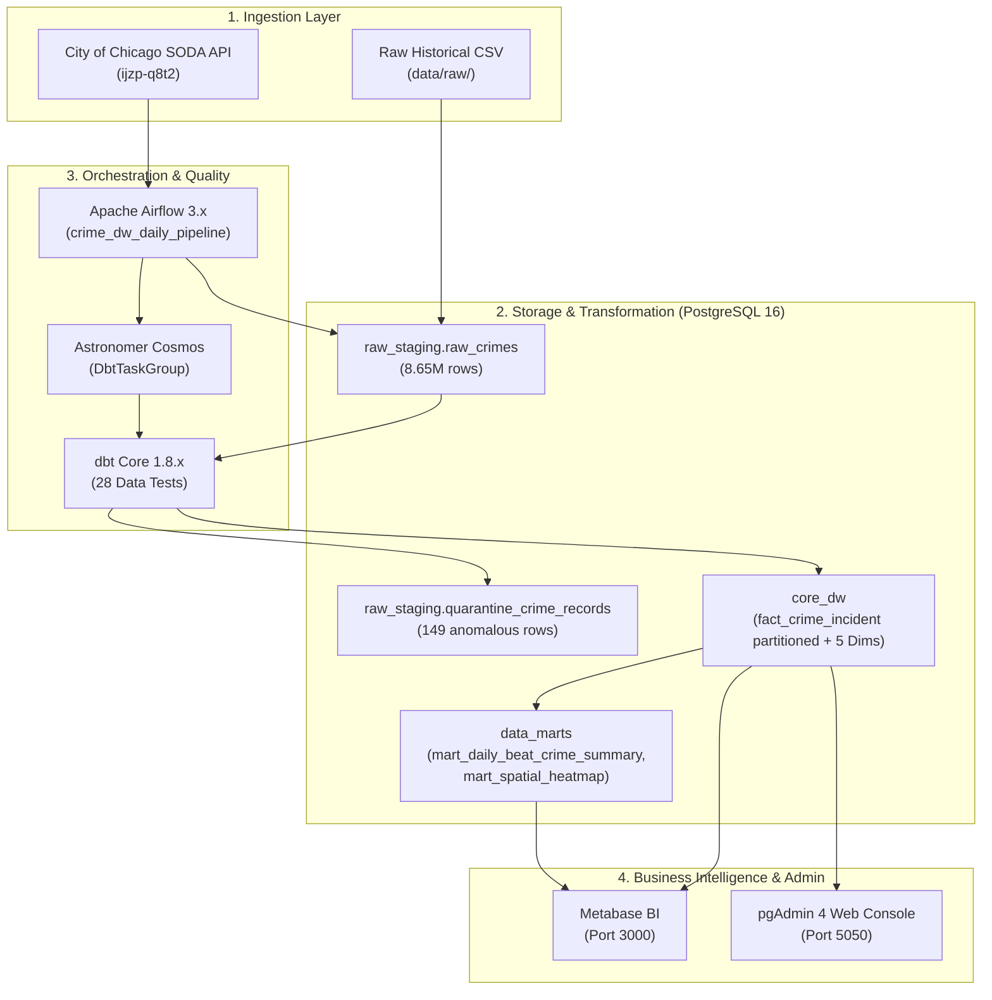

# 🏙️ Chicago Spatial-Temporal Crime Data Warehouse (Enterprise Edition)

> **Course:** Data Warehousing (06026212) — Faculty of Information Technology, KMITL  
> **Source of Truth:** [`Docs/Data_Warehouse_Architecture_Design_Document_Chicago_V3.pdf`](./Docs/Data_Warehouse_Architecture_Design_Document_Chicago_V3.pdf) & [`Docs/DWH_V01.md`](./Docs/DWH_V01.md)  
> **Tech Stack:** PostgreSQL 16 (Partitioned Star Schema), dbt Core 1.8.x, Apache Airflow 3.x + Astronomer Cosmos, Metabase BI, pgAdmin 4, Docker Compose  
> **Status:** ✅ Production Ready (8.65M+ Incidents, 100% Pass on 28 dbt Quality Gates)

---

## 📋 สารบัญ (Table of Contents)
1. [ภาพรวมโครงการและสถาปัตยกรรม (Architecture Overview)](#1-ภาพรวมโครงการและสถาปัตยกรรม-architecture-overview)
2. [คู่มือการติดตั้งและการเริ่มระบบ (Quick Start & Setup)](#2-คู่มือการติดตั้งและการเริ่มระบบ-quick-start--setup)
3. [จุดเข้าถึงบริการและรหัสผ่าน (Service Endpoints & Credentials)](#3-จุดเข้าถึงบริการและรหัสผ่าน-service-endpoints--credentials)
4. [โครงสร้างแบบจำลองคลังข้อมูล (Dimensional Modeling & Star Schema)](#4-โครงสร้างแบบจำลองคลังข้อมูล-dimensional-modeling--star-schema)
5. [การรันและควบคุมท่อข้อมูลด้วย dbt (dbt Pipeline & Testing)](#5-การรันและควบคุมท่อข้อมูลด้วย-dbt-dbt-pipeline--testing)
6. [การทำงานอัตโนมัติด้วย Apache Airflow & Cosmos (Orchestration)](#6-การทำงานอัตโนมัติด้วย-apache-airflow--cosmos-orchestration)
7. [คู่มือการใช้งานและสร้างแดชบอร์ดบน Metabase BI (Dashboard Guide)](#7-คู่มือการใช้งานและสร้างแดชบอร์ดบน-metabase-bi-dashboard-guide)
8. [กรอบการควบคุมคุณภาพข้อมูลและตารางกักกัน (Data Quality & Quarantine Gate)](#8-กรอบการควบคุมคุณภาพข้อมูลและตารางกักกัน-data-quality--quarantine-gate)
9. [การแก้ไขปัญหาที่พบบ่อย (Troubleshooting & FAQs)](#9-การแก้ไขปัญหาที่พบบ่อย-troubleshooting--faqs)

---

## 1. ภาพรวมโครงการและสถาปัตยกรรม (Architecture Overview)

ระบบคลังข้อมูลระดับองค์กรสำหรับชุดข้อมูลอาชญากรรมเมืองชิคาโก (Chicago Crime Dataset 2001–ปัจจุบัน กว่า 8.65 ล้านระเบียน) ออกแบบตามระเบียบวิธี **Kimball Dimensional Modeling** บนสถาปัตยกรรม **Modern Data Stack (MDS)** เชื่อมโยง 8 คอนเทนเนอร์เข้าด้วยกันผ่าน Docker Network:



### ผังโครงสร้างโฟลเดอร์โครงการ
```text
our_project/
├── docker-compose.yaml             # ควบคุมการทำงานของคอนเทนเนอร์ทั้ง 8 ตัว
├── dockerfile.airflow              # ปรับแต่ง Airflow Image พร้อม dbt-postgres, cosmos และ dependencies
├── postgresql.conf                 # ปรับแต่ง PostgreSQL Engine สำหรับ Analytical Workload
├── .env.example                    # ไฟล์ต้นแบบ Environment Variables
├── .env                            # ตัวแปรระบบจริง (Credentials, Ports)
├── Docs/                           # เอกสารสถาปัตยกรรมฉบับสมบูรณ์ (V3 PDF/DOCX) และ DWH_V01.md
├── data/
│   ├── raw/                        # ข้อมูลดิบ Chicago Crimes CSV
│   └── seeds/                      # ไฟล์ Boundary Lookup ย้อนหลัง (Beats, Districts, Wards, Areas)
├── scripts/
│   ├── 001_init_schemas.sql        # สร้าง Schemas, Partitioned Fact Table, Quarantine, RBAC
│   ├── fetch_daily_crimes.py       # สคริปต์ดึงข้อมูลแบบ Incremental ผ่าน Chicago SODA API
│   └── refresh_metabase_cache.py   # สคริปต์ Invalidate Cache ของ Metabase อัตโนมัติ
├── airflow/
│   ├── dags/
│   │   └── crime_dw_daily.py       # Airflow DAG ประจำวัน (Ingest -> Quarantine -> Cosmos -> Metabase)
│   ├── logs/
│   └── config/
└── dbt/
    ├── dbt_project.yml             # โครงการ dbt และการตั้งค่า Schema
    ├── profiles.yml                # Connection Profile (prod ในคอนเทนเนอร์ และ dev)
    ├── packages.yml                # Dependency: dbt_utils
    ├── models/
    │   ├── staging/
    │   │   ├── _sources.yml        # Source Data Contract
    │   │   ├── stg_crimes.sql      # Cleanse, Cast, LPAD รหัสสถานีตำรวจ และจัดมาตรฐานข้อมูล
    │   │   └── stg_quarantined_crimes.sql # Data Quality Gate ส่งข้อมูลผิดปกติเข้า Quarantine
    │   ├── core/
    │   │   ├── _core_models.yml    # Data Tests สำหรับ Conformed Dimensions และ Fact
    │   │   ├── dim_date.sql        # มิติปฏิทิน 30 ปี (2001–2030) + วันหยุดราชการ
    │   │   ├── dim_time.sql        # มิติเวลา 1,440 นาที + กะสายตรวจ CPD 3 กะ
    │   │   ├── dim_crime_type.sql  # มิติประเภทคดี IUCR + ระบุคดีอุกฉกรรจ์ (FBI Index Crimes)
    │   │   ├── dim_location_type.sql # มิติลักษณะทางกายภาพสถานที่เกิดเหตุ
    │   │   ├── dim_location.sql    # มิติพื้นที่ขอบเขตเชิงประวัติศาสตร์ (SCD Type 2)
    │   │   └── fact_crime_incident.sql # Partitioned Fact Table แบบ Incremental
    │   └── marts/
    │       ├── _marts_models.yml   # Marts Tests
    │       ├── mart_daily_beat_crime_summary.sql # Mart สรุปยอดคดีระดับ Beat x Day x Crime Type
    │       └── mart_spatial_heatmap.sql          # Mart ถ่วงน้ำหนักความหนาแน่นเชิงพิกัดสำหรับ Heatmap
    ├── seeds/                      # Lookup Tables สำหรับ CPD Reference Code
    └── snapshots/                  # dbt Snapshots สำหรับติดตามการปรับเขต (SCD Type 2)
```

---

## 2. คู่มือการติดตั้งและการเริ่มระบบ (Quick Start & Setup)

### ความต้องการของระบบ (Prerequisites)
* **Docker Desktop** (เวอร์ชัน 4.25 ขึ้นไป พร้อมเปิดใช้งาน Docker Compose V2)
* พื้นที่ว่างบนดิสก์อย่างน้อย **15–20 GB** สำหรับจัดเก็บข้อมูลคลังข้อมูลและอิมเมจ
* แรมขั้นต่ำ 8 GB (แนะนำ 16 GB ขึ้นไป)

### ขั้นตอนการเริ่มระบบ:
```bash
# 1. เข้าสู่โฟลเดอร์โปรเจกต์
cd our_project

# 2. คัดลอกไฟล์ Environment Variables
cp .env.example .env

# 3. สั่งรันบริการทั้งหมดในพื้นหลังด้วย Docker Compose
docker compose up -d

# 4. ตรวจสอบสถานะของคอนเทนเนอร์ทั้ง 8 ตัว
docker compose ps
```

---

## 3. จุดเข้าถึงบริการและรหัสผ่าน (Service Endpoints & Credentials)

| บริการ (Service) | Container Name | URL / Port | ผู้ใช้งาน (Username) | รหัสผ่าน (Password) | หมายเหตุ |
| :--- | :--- | :---: | :---: | :---: | :--- |
| **Metabase BI** | `crime_dw_metabase` | [http://localhost:3000](http://localhost:3000) | `bi_reader` | `bi_secure_pass` | แสดงผลแดชบอร์ดเชิงกลยุทธ์และสายตรวจ |
| **Apache Airflow** | `crime_dw_airflow_apiserver` | [http://localhost:8080](http://localhost:8080) | `admin` | `admin` | ควบคุม Pipeline อัตโนมัติรายวัน |
| **pgAdmin 4** | `crime_dw_pgadmin` | [http://localhost:5050](http://localhost:5050) | `admin@crimedw.com` | `admin_secret_pass` | GUI บริหารจัดการฐานข้อมูล PostgreSQL |
| **PostgreSQL 16** | `crime_dw_postgres` | `localhost:5432` | `postgres` | `postgres` | ฐานข้อมูลหลัก (Database: `crime_dw`) |
| **dbt Docs & Lineage** | `crime_dw_dbt` | [http://localhost:8088](http://localhost:8088) | - | - | แดชบอร์ดเอกสาร dbt และผัง **Interactive Data Lineage Graph** |

---

## 4. โครงสร้างแบบจำลองคลังข้อมูล (Dimensional Modeling & Star Schema)

คลังข้อมูลถูกออกแบบตามหลักสถาปัตยกรรม 3 ชั้น (**3-Tier Architecture**):

1. **`raw_staging` Layer:** พักข้อมูลดิบต้นฉบับ 22 คอลัมน์ และบันทึกประวัติการโหลด (`_loaded_at`, `_batch_id`)
2. **`core_dw` Layer (Star Schema):**
   * **Fact Table:** `core_dw.fact_crime_incident` (Partitioned by Year) บันทึกระดับ Atomic Grain (1 แถว = 1 คดี) รวม 8,659,435 คดี
   * **Dimension Tables:**
     * `dim_date`: วันที่, เดือน, ไตรมาส, ปี, `is_weekend`, `is_holiday`
     * `dim_time`: ชั่วโมง, นาที, ช่วงเวลา, กะสายตรวจ (`Morning`, `Afternoon`, `Night`)
     * `dim_crime_type`: รหัส IUCR, หมวดหมู่คดี, รายละเอียด, และ `is_index_crime` (ตามเกณฑ์ FBI)
     * `dim_location_type`: ลักษณะสถานที่ทางกายภาพ (Street, Residence, Sidewalk ฯลฯ)
     * `dim_location`: ขอบเขตพื้นที่เชิงประวัติศาสตร์ (Beat, District, Ward, Community Area) รองรับ **SCD Type 2**
3. **`data_marts` Layer:**
   * `mart_daily_beat_crime_summary`: พรีแอกกริเกตระดับวันและเขตตรวจ สำหรับวิเคราะห์แนวโน้มและอัตราการจับกุม
   * `mart_spatial_heatmap`: พิกัดจุดกึ่งกลาง (Centroid Latitude/Longitude) พร้อมคะแนนถ่วงน้ำหนักความรุนแรง (`severity_weight`)

---

## 5. การรันและควบคุมท่อข้อมูลด้วย dbt (dbt Pipeline & Testing)

ระบบมีคอนเทนเนอร์ `crime_dw_dbt` สำหรับรันคำสั่งการแปลงข้อมูลได้โดยตรงจากเครื่องโฮสต์:

### 1. การคอมไพล์และรันโมเดลทั้งหมด
```powershell
docker exec -it crime_dw_dbt dbt run
```

### 2. การรันเฉพาะโมเดลและตารางที่เกี่ยวข้อง (Downstream Run)
หากมีการแก้ไขในชั้น Staging เช่น [`stg_crimes.sql`](file:///c:/Users/User/Downloads/IT_KMITL_Education/year3/semester_1/DataWarehouse/data-warehouse-2026-byNoppo/our_project/dbt/models/staging/stg_crimes.sql):
```powershell
# รันโมเดล stg_crimes และตารางลูกทั้งหมดที่ต่อจากโมเดลนี้
docker exec -it crime_dw_dbt dbt run -s stg_crimes+

# หรือระบุชื่อโมเดลเฉพาะเจาะจง
docker exec -it crime_dw_dbt dbt run -s stg_crimes dim_location mart_daily_beat_crime_summary mart_spatial_heatmap
```

### 3. การรันชุดทดสอบคุณภาพข้อมูลอัตโนมัติ (dbt Test Suite)
```powershell
docker exec -it crime_dw_dbt dbt test
```
*ระบบผ่านการทดสอบคุณภาพข้อมูลครบถ้วน **28/28 รายการ (100% Pass, 0 Warnings, 0 Failures)***

### 4. การสร้างและเปิดดูเอกสาร dbt Documentation
```powershell
docker exec -it crime_dw_dbt dbt docs generate
```

---

## 6. การทำงานอัตโนมัติด้วย Apache Airflow & Cosmos (Orchestration)

* **DAG Name:** `crime_dw_daily_pipeline` ([airflow/dags/crime_dw_daily.py](file:///c:/Users/User/Downloads/IT_KMITL_Education/year3/semester_1/DataWarehouse/data-warehouse-2026-byNoppo/our_project/airflow/dags/crime_dw_daily.py))
* **Schedule:** รันทุกวันเวลา `02:00 AM America/Chicago` (14:00 น. เวลาประเทศไทย)
* **Pipeline Sequence:**
  1. `ingest_raw_crime_data`: ดึงข้อมูลคดีใหม่และอัปเดตย้อนหลัง 3 วันผ่าน Chicago SODA API
  2. `stg_quarantined_crimes`: ตรวจสอบความถูกต้องและคัดแยกข้อมูลชำรุดเข้าตาราง Quarantine
  3. `dbt_transforms_and_tests` (**Astronomer Cosmos**): แปลงข้อมูลเข้า Core DW, รัน dbt Tests คุณภาพข้อมูล และอัปเดต Data Marts
  4. `refresh_metabase_cache`: ยิง API รีเฟรชแคชแดชบอร์ดบน Metabase อัตโนมัติ

---

## 7. คู่มือการใช้งานและสร้างแดชบอร์ดบน Metabase BI (Dashboard Guide)

แดชบอร์ดถูกแบ่งออกเป็น 2 มุมมองหลัก เพื่อตอบสนองคำถามทางธุรกิจ (**BR01–BR08**) และตัวชี้วัด (**M01–M08**):

### แดชบอร์ดที่ 1: Executive Decision Dashboard (ภาพรวมเชิงกลยุทธ์สำหรับผู้บริหาร)

| รายการการ์ด / ชาร์ต | คำถามและตัวชี้วัด | สูตรการคำนวณ / วิธีการสร้าง |
| :--- | :---: | :--- |
| **Total Incidents** | **BR01 / M01** | `SUM(total_incidents)` = **8,659,435 Incidents** |
| **Total Arrests** | **BR03 / M02** | `SUM(total_arrests)` = **2,162,197 Arrested** |
| **Overall Arrest Rate %** | **BR03 / M03** | Non-additive Formula: `100.0 * Sum([Total Arrests]) / Sum([Total Incidents])` = **24.97 %** |
| **Total Domestic Violence** | **BR04 / M04** | `SUM(total_domestic)` = **1,499,540** |
| **Domestic Violence Ratio %** | **BR04 / M05** | Non-additive Formula: `100.0 * Sum([Total Domestic]) / Sum([Total Incidents])` = **17.32 %** |
| **Total Index Crimes** | **BR05 / M06** | `SUM(total_index_crimes)` = **3,546,446** (คดีอุกฉกรรจ์ตามเกณฑ์ FBI) |
| **Top 10 Lowest Arrest Rate by Crime Type** | **BR03** | กราฟแท่งแนวนอน (Row Chart) เรียงลำดับจากอัตราจับกุมต่ำสุด (Burglary, Theft, Motor Vehicle Theft) เพื่อชี้เป้าประสิทธิภาพ |
| **Weekend vs Weekday Crime** | **BR01** | กราฟเปรียบเทียบสถิติคดีระหว่างวันทำงานปกติ และวันหยุดสุดสัปดาห์ (`is_weekend`) |
| **Monthly Crime Trend** | **BR01** | กราฟเส้นแสดงสถิติคดีรายเดือนย้อนหลังตั้งแต่ปี 2001 ถึงปัจจุบัน |
| **Annual Crime Trend & YoY Growth %** | **BR01 / M07** | กราฟเส้นวิเคราะห์อัตราการเติบโตเทียบปีก่อนหน้า (%) พร้อม Baseline 0% |
| **Top 5 Police Districts** | **BR05** | กราฟแท่งจัดอันดับสถานีตำรวจที่มีคดีสูงสุด (District 12, 09, 06, 02, 04) |

> **💡 เทคนิคการตั้งค่าแกน X สำหรับกราฟปี (Year):**  
> เพื่อไม่ให้ Metabase ใส่เครื่องหมาย `,` ในตัวเลขปี (เช่น `2,025`):
> * ในโค้ด SQL ให้ cast คอลัมน์ปีเป็นข้อความ: `crime_year::TEXT AS "Year"` หรือ
> * ในหน้าต่าง Visualization Settings ➔ แท็บ **Axes/Data** ➔ คลิกฟันเฟืองที่คอลัมน์ `Year` ➔ ตั้งค่า **Use thousands separator** เป็น **Off**

---

### แดชบอร์ดที่ 2: Tactical Patrol Dashboard (การวางแผนกำลังพลและสายตรวจ)

| รายการการ์ด / ชาร์ต | คำถามและตัวชี้วัด | รายละเอียดและการนำไปใช้งาน |
| :--- | :---: | :--- |
| **Chicago Spatial Crime Heatmap** | **BR02 / M08** | แผนที่แสดงความหนาแน่นเชิงพิกัด (`centroid_latitude`, `centroid_longitude`) ตอบสนองรวดเร็ว $\le 1.5$ วินาที |
| **Patrol Shift Distribution** | **BR02** | Donut Chart แบ่งสัดส่วน 3 กะสายตรวจ: `Afternoon Shift (16:00-24:00)`, `Morning Shift (08:00-16:00)`, `Night Shift (00:00-08:00)` |
| **Hourly Crime Distribution** | **BR02** | กราฟเส้นแสดงช่วงเวลาเสี่ยงสูงสุดในรอบวัน (Peak Hours) รายชั่วโมง 0–24 น. |
| **High-Risk Beats Ranking** | **BR02 / BR07** | ตารางจัดอันดับเขตตรวจย่อยที่ต้องเฝ้าระวังพิเศษ (Beat Code, District, Community Area, Density Weight, Incidents) |
| **Top 10 Locations for Urban Planners** | **BR06** | กราฟแท่งแนวนอนวิเคราะห์สถานที่เกิดเหตุทางกายภาพ (Street, Residence, Apartment, Sidewalk ฯลฯ) สำหรับฝ่ายผังเมือง |

---

## 8. กรอบการควบคุมคุณภาพข้อมูลและตารางกักกัน (Data Quality & Quarantine Gate)

ระบบติดตั้งระบบตรวจสอบคุณภาพข้อมูลก่อนนำเข้า Core DW (อ้างอิงตารางที่ 25 ในเอกสาร V3):
1. **Uniqueness:** คอลัมน์ `source_id` ต้องไม่ซ้ำใน `core_dw.fact_crime_incident`
2. **Completeness:** คอลัมน์หลัก (`case_number`, `date`, `primary_type`, `iucr`) ต้องไม่เป็นค่าว่าง (NOT NULL)
3. **Validity:**
   * วันที่เกิดเหตุต้องไม่เกินวันปัจจุบัน (`date <= CURRENT_TIMESTAMP`)
   * พิกัดภูมิศาสตร์ต้องอยู่ในขอบเขตเมืองชิคาโกจริง (`41.60 <= lat <= 42.05`, `-87.94 <= lon <= -87.52`)
4. **Quarantine Isolation:** แถวที่ไม่ผ่านเกณฑ์จะถูกคัดแยกเข้าตาราง `raw_staging.quarantine_crime_records` พร้อมระบุเหตุผล (`reject_reason`) โดยไม่ขัดขวางการทำงานของคลังข้อมูลหลัก

---

## 9. การแก้ไขปัญหาที่พบบ่อย (Troubleshooting & FAQs)

### Q1: เข้าใช้งาน pgAdmin แล้วขึ้นแจ้งเตือน `Email/Username is not valid`?
* **วิธีแก้:** ตรวจสอบอีเมลใน [`.env`](file:///c:/Users/User/Downloads/IT_KMITL_Education/year3/semester_1/DataWarehouse/data-warehouse-2026-byNoppo/our_project/.env) หรือรันด้วยอีเมลมาตรฐาน: `admin@crimedw.com` และรหัสผ่าน `admin_secret_pass`

### Q2: ต้องการตรวจสอบจำนวนแถวของตารางทั้งหมดในฐานข้อมูลด้วยตนเอง?
* **วิธีแก้:** รันคำสั่ง SQL ผ่าน psql ในคอนเทนเนอร์ Postgres:
  ```powershell
  docker exec -it crime_dw_postgres psql -U postgres -d crime_dw -c "
  SELECT table_schema, table_name, pg_size_pretty(pg_total_relation_size('\"' || table_schema || '\".\"' || table_name || '\"')) AS size
  FROM information_schema.tables 
  WHERE table_schema IN ('raw_staging', 'core_dw', 'data_marts')
  ORDER BY table_schema, table_name;"
  ```

### Q3: หลังจากแก้ไขโค้ด dbt ต้องรีสตาร์ต Docker หรือไม่?
* **วิธีแก้:** **ไม่ต้องรีสตาร์ต Docker** คอนเทนเนอร์เชื่อมต่อกับโฟลเดอร์ไฟล์บนโฮสต์แบบ Volume Mounting เพียงแค่รันคำสั่ง:
  ```powershell
  docker exec -it crime_dw_dbt dbt run -s <ชื่อโมเดล>
  ```
  จากนั้นกดรีเฟรชหน้าเว็บ Metabase (F5) ข้อมูลจะอัปเดตทันทีครับ
